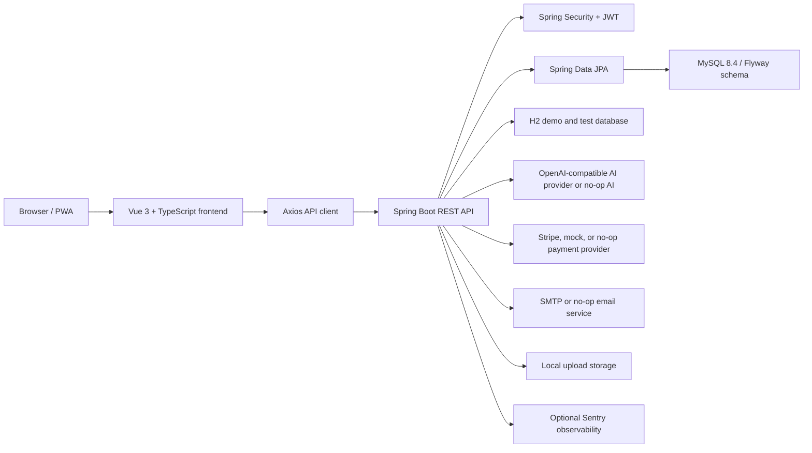

# MandarinSpark - AI-Powered Interactive Chinese Learning Platform

MandarinSpark is a full-stack web application for young Mandarin learners in Malaysia. It was built as a Final Year Project to demonstrate how a modern learning platform can combine guided course content, live and recorded learning, gamified practice, AI-assisted study support, teacher workflows, admin governance, and sandbox commerce in one browser-based product.

The platform is designed around three main personas:

- Students learn through public course discovery, lessons, quizzes, interactive activities, live classes, recorded videos, rewards, and an AI helper.
- Teachers manage learning modules, lessons, course packages, quizzes, live classes, recorded videos, student progress, feedback, profile verification, and earnings.
- Administrators manage users, teacher verification, published content, activity libraries, reports, moderation, payments, refunds, payouts, analytics, platform settings, notifications, and audit logs.

The project can run as a normal full-stack application with MySQL, as a persistent desktop demo with file-backed H2, as an in-memory backend demo, or as a frontend-only preview for presentations without any backend service.

## Table of Contents

- [Project Highlights](#project-highlights)
- [Feature Overview](#feature-overview)
- [Architecture](#architecture)
- [Tech Stack](#tech-stack)
- [Repository Structure](#repository-structure)
- [Prerequisites](#prerequisites)
- [Quick Start Options](#quick-start-options)
- [Backend Setup](#backend-setup)
- [Frontend Setup](#frontend-setup)
- [Environment Variables](#environment-variables)
- [API Overview](#api-overview)
- [Data and Storage](#data-and-storage)
- [Security and Privacy](#security-and-privacy)
- [Testing and Quality Checks](#testing-and-quality-checks)
- [Production Notes](#production-notes)
- [Troubleshooting](#troubleshooting)
- [License](#license)

## Project Highlights

- Role-based learning platform with student, teacher, and admin workspaces.
- Public course catalog with course detail pages before sign-in.
- JWT authentication with short-lived access tokens and rotating HttpOnly refresh cookies.
- Student learning dashboard with progress, quizzes, rewards, streaks, activities, live classes, recorded videos, and feedback.
- Interactive activity library covering flashcards, matching games, listening exercises, tracing exercises, drag-and-drop activities, and story activities.
- AI learning helper with chat, streaming chat, vocabulary help, sentence practice, quiz generation, story generation, learning recommendations, pronunciation feedback, writing feedback, usage logs, rate limits, and student report workflows.
- Teacher content management for modules, lessons, packages, quizzes, live classes, recorded video uploads, enrolments, verification documents, student progress, feedback, and earnings.
- Admin management for users, teacher approvals, content moderation, activity CRUD, reports, payments, refunds, payouts, commission settings, platform settings, analytics, notifications, and audit logs.
- Stripe-compatible payment integration with no-op and mock providers for local or demo use.
- Optional SMTP email support for password reset workflows.
- Optional Sentry observability on both frontend and backend, with sensitive data scrubbing.
- PWA support with auto-update service worker and static asset caching.
- Complete interface localization for English, Bahasa Melayu, and Simplified Chinese across public, student,
  teacher, admin, loading, error, and system pages.
- Local demo paths that do not require real AI, Stripe, SMTP, or MySQL credentials.

## Feature Overview

### Public Visitor

| Area                 | Capabilities                                                                              |
| -------------------- | ----------------------------------------------------------------------------------------- |
| Landing page         | Child-friendly product introduction, safety messaging, featured courses, support sections |
| Course discovery     | Browse public courses, filter catalog data, inspect course details before signing in      |
| Account access       | Student registration, teacher registration, sign-in, refresh session, logout              |
| Password recovery    | Forgot-password and reset-password flows with URL/token hygiene                           |
| Legal pages          | Terms of service and privacy policy pages                                                 |
| Payment result pages | Success and cancellation pages for checkout return URLs                                   |

### Student Workspace

| Area           | Capabilities                                                                                                                     |
| -------------- | -------------------------------------------------------------------------------------------------------------------------------- |
| Home dashboard | Learning progress, points, badges, weak areas, unfinished lessons, recommended next step                                         |
| Learn          | Lesson player data, recorded videos, live class links, progress tracking                                                         |
| Practice       | Interactive activity library with multiple activity types                                                                        |
| Quiz           | Student quiz listing, quiz attempt submission, result review, wrong-answer review                                                |
| Classes        | Live class discovery, enrolment, cancellation, join access                                                                       |
| Achievements   | Learning milestones, badges, and progress signals                                                                                |
| Rewards        | Points history, streaks, level progress, badge collection                                                                        |
| AI helper      | Chat, vocabulary support, sentence practice, story generation, quiz generation, learning recommendations, and response reporting |
| Profile        | Account context, teacher feedback, payments, refunds, and notifications                                                          |

### Teacher Workspace

| Area              | Capabilities                                                                                             |
| ----------------- | -------------------------------------------------------------------------------------------------------- |
| Dashboard         | Teaching overview, content status, student activity, and operational metrics                             |
| Content           | Create and update learning modules, lessons, course packages, package items, quizzes, and quiz questions |
| Classes           | Create, update, reschedule, cancel, and monitor live classes                                             |
| Recorded learning | Upload recorded videos, update metadata, archive videos, stream lesson videos                            |
| Students          | View student summaries, learning signals, quiz attempts, and video progress                              |
| Feedback          | Send and update teacher feedback for students                                                            |
| Verification      | Upload verification documents and resubmit rejected applications                                         |
| Earnings          | View earnings, payout summaries, and payout requests                                                     |
| Profile           | Update public teaching profile and account information                                                   |

### Admin Workspace

| Area                   | Capabilities                                                                                                          |
| ---------------------- | --------------------------------------------------------------------------------------------------------------------- |
| Dashboard              | Platform-wide summary metrics and operational status                                                                  |
| Users                  | Search users, inspect students and teachers, activate or deactivate accounts                                          |
| Teacher verification   | Review teacher applications, download documents, approve or reject profiles                                           |
| Content review         | Inspect content submissions and archive unsafe or unsuitable content                                                  |
| Activity library       | Manage flashcards, matching games, listening exercises, tracing exercises, drag-drop activities, and story activities |
| Reports and moderation | Review AI response reports, moderation records, audit logs, and content actions                                       |
| Finance                | Review payments, refund requests, payout requests, and platform commission settings                                   |
| Analytics              | Student, teacher, payment, content, and AI usage breakdowns                                                           |
| Settings               | Platform settings, support navigation, audit visibility, and operational controls                                     |

## Architecture



### Frontend Architecture

- Vue 3 Composition API with TypeScript.
- Vue Router owns public, student, teacher, admin, unauthorized, and not-found routes.
- Pinia stores manage auth and UI state.
- Axios wrapper centralizes API base URL handling, bearer-token attachment, refresh-token recovery, and auth invalidation.
- `src/api/services.ts` is the typed frontend API layer for auth, public catalog, student, teacher, admin, AI, payments, notifications, and health checks.
- `src/demo/data.ts` contains strictly typed preview fixtures used only when demo flags are enabled; `src/demo/users.ts` holds the small preview account records separately.
- `src/config/env.ts` validates and normalizes build-time environment variables.
- `src/config/navigation.ts` is the single source of truth for sidebar and public navigation.
- `src/plugins/i18n.ts` provides English, Bahasa Melayu, and Simplified Chinese shared labels; every public and
  workspace page loads its route-local message bundle when visited.
- `src/plugins/pwa.ts` registers the PWA service worker in production-like builds.
- `src/plugins/observability.ts` initializes Sentry only when a DSN is configured and scrubs sensitive request data.

### Backend Architecture

- Spring Boot 3.5 with Java 21.
- Spring Security protects API routes with JWT access tokens and refresh-token cookies.
- Spring Data JPA models the learning, commerce, AI, communication, and platform administration domains.
- Flyway manages the MySQL runtime schema.
- H2 is used for demo and test profiles.
- SpringDoc exposes OpenAPI JSON at `/v3/api-docs` and Swagger UI at `/swagger-ui.html`.
- Service layer separates auth, dashboard, learning, content, AI, commerce, payment, email, storage, moderation, analytics, notifications, and audit workflows.
- Provider abstractions support no-op/mock/real integrations for AI, payments, and email.
- Runtime guards validate risky production configuration such as JWT secrets, payment provider setup, and AI provider setup.

## Tech Stack

| Layer                      | Technology                                                        |
| -------------------------- | ----------------------------------------------------------------- |
| Frontend framework         | Vue 3, TypeScript, Vite                                           |
| Frontend state and routing | Pinia, Vue Router                                                 |
| Frontend i18n              | Vue I18n                                                          |
| Frontend HTTP              | Axios                                                             |
| Frontend tests             | Vitest, Vue Test Utils, Testing Library DOM, jsdom                |
| Frontend quality           | ESLint, Prettier, vue-tsc                                         |
| PWA                        | vite-plugin-pwa, Workbox                                          |
| Backend framework          | Java 21, Spring Boot 3.5                                          |
| Backend security           | Spring Security, JWT, refresh cookies, rate limiting              |
| Backend persistence        | Spring Data JPA, Hibernate                                        |
| Database                   | MySQL 8.4 for local/runtime, H2 for demo/test                     |
| Migration                  | Flyway                                                            |
| API docs                   | SpringDoc OpenAPI, Swagger UI                                     |
| AI integration             | DeepSeek or any OpenAI-compatible provider, plus no-op local mode |
| Payments                   | Stripe provider, mock provider, no-op provider                    |
| Email                      | SMTP provider, no-op provider                                     |
| Observability              | Sentry frontend and backend integrations                          |
| Containers                 | Docker Compose for local MySQL                                    |

## Repository Structure

```text
.
|-- backend/
|   |-- .env.example
|   |-- docker-compose.yml
|   |-- mvnw / mvnw.cmd
|   |-- pom.xml
|   `-- src/
|       |-- main/java/com/example/aichinese/
|       |   |-- config/          Application, security, provider, OpenAPI, and runtime guards
|       |   |-- controller/      REST controllers grouped by public/auth/student/teacher/admin/AI/payment
|       |   |-- dto/             Request and response contracts
|       |   |-- entity/          JPA entities and enums
|       |   |-- exception/       Global API error handling
|       |   |-- mapper/          Entity-to-DTO mapping helpers
|       |   |-- provider/        Payment provider implementations
|       |   |-- repository/      Spring Data repositories
|       |   |-- security/        JWT, user details, auth entrypoints, and rate limiting
|       |   |-- service/         Business workflows and provider abstractions
|       |   `-- util/            Shared utilities
|       |-- main/resources/
|       |   |-- application.yml
|       |   |-- application-local.yml
|       |   |-- application-demo.yml
|       |   `-- db/migration/
|       `-- test/                Backend unit and integration tests
|
|-- frontend/
|   |-- .env.example
|   |-- package.json
|   |-- vite.config.ts
|   `-- src/
|       |-- api/                 Axios client and typed API wrappers
|       |-- components/          Common, dashboard, layout, and public UI components
|       |-- composables/         Reusable Vue resource/loading helpers
|       |-- config/              Environment and navigation config
|       |-- demo/                Typed preview fixture data
|       |-- layouts/             Public and dashboard layouts
|       |-- pages/               Public, student, teacher, admin, and system pages
|       |-- plugins/             i18n, PWA, observability
|       |-- router/              Route definitions and guards
|       |-- stores/              Pinia stores
|       |-- styles/              Global CSS
|       |-- types/               Shared frontend API types
|       `-- utils/               Formatting, storage, role, URL, download, and security helpers
|
`-- README.md
```

## Prerequisites

- Java 21.
- Maven is not required globally because the backend includes Maven Wrapper.
- Node.js 22. The frontend package declares `engines.node` as `>=22 <23`.
- npm, included with Node.js.
- Docker Desktop, or a local MySQL 8 database, for the normal MySQL workflow.

Recommended local tools:

- Git.
- A Java IDE such as IntelliJ IDEA or VS Code.
- A browser with modern ES module support.
- Postman, Insomnia, or Swagger UI for manual API exploration.

## Quick Start Options

Choose the workflow that matches what you want to demonstrate or develop.

### Option 0: One-Click Windows Desktop Demo

On Windows with Java 21 and Node.js 22 installed, open `Start FYP.cmd` in the repository root. It builds the backend, installs frontend dependencies if needed, starts both services, waits for health checks, and opens `http://127.0.0.1:5174`. Use `Stop FYP.cmd` to stop only the processes started by this project.

The desktop demo uses the `demo,desktop` profiles. Its H2 database is stored in `.local/data/`, so accounts and progress survive a restart. On the first start, the app creates one admin, one approved teacher, one student, three free published lessons, and one free published course package. Login emails are `admin@fyp.local`, `teacher@fyp.local`, and `student@fyp.local`; their generated passwords are in `.local/admin.env`. Keep that file private. Local logs and process IDs also live under `.local/`, which Git ignores.

For a status check, run `powershell -File scripts/local.ps1 -Action Status`. The demo profile uses mock payments and has no real AI or SMTP service configured.

### Option 1: Frontend-Only Preview

Use this when you want to present the UI without starting the backend or database.

```powershell
cd frontend
Copy-Item .env.example .env.local
```

Edit `frontend/.env.local`:

```text
VITE_API_BASE_URL=/api/v1
VITE_USE_DEMO_DATA=true
VITE_ENABLE_PREVIEW_MODE=true
```

Install dependencies and start Vite:

```powershell
npm ci
npm run dev
```

Open:

```text
http://localhost:5174/auth
```

Use the Preview Student, Preview Teacher, or Preview Admin buttons on the sign-in page. This mode uses typed fixture data from `frontend/src/demo/data.ts` and is read-only.

### Option 2: Full Stack Demo with H2

Use this when you want the backend API running but do not want to install or start MySQL.

```powershell
cd backend
$env:DEFAULT_ADMIN_EMAIL = "admin@example.com"
$env:DEFAULT_ADMIN_PASSWORD = "Admin12345"
.\mvnw.cmd spring-boot:run "-Dspring-boot.run.profiles=demo"
```

The demo profile:

- Runs on `127.0.0.1:8080`.
- Uses an in-memory H2 database.
- Creates and drops the schema on each run.
- Disables Flyway.
- Uses mock payment behavior.
- Disables real AI provider calls.
- Disables SMTP email.
- Seeds a small public course catalog and demo teacher/student accounts. Set `DEMO_TEACHER_PASSWORD` and `DEMO_STUDENT_PASSWORD` before first start if you need known credentials.

Then start the frontend in a second terminal:

```powershell
cd frontend
npm ci
npm run dev
```

Open:

```text
http://localhost:5174
```

### Option 3: Normal Local Development with MySQL

Use this when you want the closest local workflow to a real runtime profile.

Start MySQL:

```powershell
cd backend
docker compose up -d
```

Run the backend:

```powershell
cd backend
$env:DB_USERNAME = "aichinese_app"
$env:DB_PASSWORD = "replace-with-a-strong-application-db-password"
$env:JWT_SECRET = "local-development-secret-with-at-least-32-characters"
$env:DEFAULT_ADMIN_EMAIL = "admin@example.com"
$env:DEFAULT_ADMIN_PASSWORD = "Admin12345"
.\mvnw.cmd spring-boot:run "-Dspring-boot.run.profiles=local"
```

Run the frontend:

```powershell
cd frontend
npm ci
npm run dev
```

Open:

```text
http://localhost:5174
```

## Backend Setup

### Backend URLs

| Purpose         | URL                                     |
| --------------- | --------------------------------------- |
| API base        | `http://localhost:8080/api/v1`          |
| Health check    | `http://localhost:8080/api/v1/health`   |
| Swagger UI      | `http://localhost:8080/swagger-ui.html` |
| OpenAPI JSON    | `http://localhost:8080/v3/api-docs`     |
| Actuator health | `http://localhost:8080/actuator/health` |

### Backend Commands

Windows PowerShell:

```powershell
cd backend
.\mvnw.cmd test
.\mvnw.cmd spring-boot:run "-Dspring-boot.run.profiles=local"
.\mvnw.cmd clean package
```

macOS or Linux:

```bash
cd backend
./mvnw test
./mvnw spring-boot:run -Dspring-boot.run.profiles=local
./mvnw clean package
```

### MySQL Commands

Run these from `backend/`:

```powershell
docker compose up -d
docker compose logs -f mysql
docker compose down
```

To wipe the local database volume:

```powershell
docker compose down -v
```

Be careful with `down -v`; it deletes the named MySQL volume used by this project.

## Frontend Setup

### Frontend URL

```text
http://localhost:5174
```

The Vite dev server runs on port `5174` with `strictPort: true`. It proxies `/api/v1` to `http://127.0.0.1:8080`, so the default frontend API base can stay as `/api/v1` during local development.

### Frontend Commands

```powershell
cd frontend
npm ci
npm run dev
npm run lint
npm run format:check
npm run typecheck
npm run test:unit
npm run test:e2e
npm run build
npm run preview
```

### Frontend Environment

Create `frontend/.env.local` only when you want to override defaults:

```text
VITE_API_BASE_URL=/api/v1
VITE_USE_DEMO_DATA=false
VITE_ENABLE_PREVIEW_MODE=false
VITE_SENTRY_DSN=
VITE_APP_RELEASE=
VITE_GIT_SHA=
```

For frontend-only preview mode:

```text
VITE_USE_DEMO_DATA=true
VITE_ENABLE_PREVIEW_MODE=true
```

## Environment Variables

`backend/.env.example` and `frontend/.env.example` are the source templates. Do not commit local `.env`, `.env.local`, secrets, upload folders, build outputs, or dependency folders.

### Backend Core Variables

| Variable                   | Purpose                                | Typical local value     |
| -------------------------- | -------------------------------------- | ----------------------- |
| `SERVER_PORT`              | Backend HTTP port                      | `8080`                  |
| `DB_HOST`                  | MySQL host                             | `localhost`             |
| `DB_PORT`                  | MySQL host port                        | `3307`                  |
| `DB_NAME`                  | Database name                          | `ai_chinese_learning`   |
| `DB_USERNAME`              | Application database user              | `aichinese_app`         |
| `DB_PASSWORD`              | Application database password          | Local strong password   |
| `DB_ROOT_PASSWORD`         | MySQL root password for Docker Compose | Local strong password   |
| `JWT_SECRET`               | JWT signing secret                     | At least 32 characters  |
| `DEFAULT_ADMIN_EMAIL`      | Optional seeded admin email            | `admin@example.com`     |
| `DEFAULT_ADMIN_PASSWORD`   | Optional seeded admin password         | Strong local password   |
| `FRONTEND_BASE_URL`        | Used for payment and reset links       | `http://localhost:5174` |
| `APP_CORS_ALLOWED_ORIGINS` | Allowed frontend origins               | Local Vite origins      |

### Backend AI Variables

| Variable                  | Purpose                                 |
| ------------------------- | --------------------------------------- |
| `AI_PROVIDER`             | Provider name, defaulting to `deepseek` |
| `AI_API_BASE_URL`         | OpenAI-compatible API base URL          |
| `AI_API_KEY`              | Real provider API key                   |
| `AI_MODEL_NAME`           | Model name                              |
| `AI_ENABLE_REAL_PROVIDER` | Must be `true` to call a real provider  |
| `AI_REQUESTS_PER_MINUTE`  | Per-minute AI usage limit               |
| `AI_REQUESTS_PER_DAY`     | Per-day AI usage limit                  |

By default, real AI calls are disabled. This keeps local and demo usage safe when no provider key is configured.

### Backend Payment Variables

| Variable                       | Purpose                                    |
| ------------------------------ | ------------------------------------------ |
| `PAYMENT_PROVIDER`             | `no-op`, `mock`, or Stripe-backed provider |
| `PAYMENT_SUCCESS_URL`          | Checkout success return URL                |
| `PAYMENT_CANCEL_URL`           | Checkout cancellation return URL           |
| `PAYMENT_MOCK_SUCCESS_ENABLED` | Enables mock successful checkout behavior  |
| `STRIPE_API_BASE_URL`          | Stripe API base                            |
| `STRIPE_API_KEY`               | Stripe secret key                          |
| `STRIPE_WEBHOOK_SECRET`        | Stripe webhook signing secret              |

### Backend Email and Upload Variables

| Variable                         | Purpose                          |
| -------------------------------- | -------------------------------- |
| `SMTP_ENABLED`                   | Enables real SMTP sending        |
| `SMTP_HOST`, `SMTP_PORT`         | SMTP server configuration        |
| `SMTP_USERNAME`, `SMTP_PASSWORD` | SMTP credentials                 |
| `SMTP_FROM`                      | Sender address                   |
| `PASSWORD_RESET_BASE_URL`        | Password reset URL base          |
| `UPLOAD_DIR`                     | Local upload directory           |
| `RECORDED_VIDEO_UPLOAD_DIR`      | Recorded video storage directory |
| `MAX_FILE_SIZE`                  | General upload size limit        |
| `MAX_VIDEO_FILE_SIZE`            | Recorded video upload size limit |

### Frontend Variables

| Variable                            | Purpose                                   |
| ----------------------------------- | ----------------------------------------- |
| `VITE_API_BASE_URL`                 | API base URL, default `/api/v1`           |
| `VITE_USE_DEMO_DATA`                | Enables local typed fixture fallback data |
| `VITE_ENABLE_PREVIEW_MODE`          | Enables preview persona buttons           |
| `VITE_SENTRY_DSN`                   | Optional frontend Sentry DSN              |
| `VITE_APP_RELEASE` / `VITE_GIT_SHA` | Optional release metadata                 |

## API Overview

The backend returns versioned REST APIs under `/api/v1`.

| API Group          | Base Path                                                          | Purpose                                                                                     |
| ------------------ | ------------------------------------------------------------------ | ------------------------------------------------------------------------------------------- |
| Health             | `/api/v1/health`                                                   | Public application health check                                                             |
| Auth               | `/api/v1/auth`                                                     | Register, login, refresh, current user, logout, password reset                              |
| Public             | `/api/v1/public`                                                   | Public teachers, levels, categories, platform settings, courses                             |
| Notifications      | `/api/v1/notifications`                                            | User notification list, unread count, mark read, mark all read                              |
| AI                 | `/api/v1/ai`                                                       | Availability, chat, streaming chat, learning tools, AI reports                              |
| Students           | `/api/v1/students`                                                 | Dashboard, lessons, live classes, quizzes, rewards, progress, cart, checkout, refunds       |
| Student Activities | `/api/v1/students/activities`                                      | Student activity library and completion APIs                                                |
| Student Feedback   | `/api/v1/students/feedback`                                        | Student view of teacher feedback                                                            |
| Teachers           | `/api/v1/teachers`                                                 | Dashboard, analytics, profile, verification, content, classes, videos, quizzes, students    |
| Teacher Feedback   | `/api/v1/teachers/feedback`                                        | Create, list, and update teacher feedback                                                   |
| Teacher Commerce   | `/api/v1/teachers/earnings` and `/api/v1/teachers/payout-requests` | Earnings and payout requests                                                                |
| Admin              | `/api/v1/admin`                                                    | Dashboard, analytics, users, teachers, verification, content, moderation, finance, settings |
| Admin Activities   | `/api/v1/admin/activities`                                         | Activity library CRUD                                                                       |
| Payments           | `/api/v1/payments`                                                 | Payment status and Stripe webhook entrypoint                                                |

Swagger UI is available locally at:

```text
http://localhost:8080/swagger-ui.html
```

For protected endpoints, sign in through `POST /api/v1/auth/login`, copy the returned JWT access token, and use the Swagger Authorize button. Enter the raw JWT only; Swagger adds the `Bearer` prefix.

## Data and Storage

### Main Domain Areas

- Identity: users, roles, student profiles, teacher profiles, teacher verification documents, verification reviews.
- Learning catalog: levels, categories, modules, lessons, course packages, package items.
- Live and recorded learning: live classes, enrolments, recorded videos, video progress.
- Practice and assessment: quizzes, quiz questions, quiz options, quiz attempts, wrong answers, flashcards, matching games, listening exercises, tracing exercises, drag-drop activities, story activities.
- Rewards: badges, student badges, points transactions, daily streaks.
- AI: chat sessions, chat messages, AI usage logs, usage quota counters, AI feedback records, AI response reports.
- Commerce: carts, orders, order items, payment records, entitlements, refunds, teacher earnings, payouts, commission settings.
- Communication and governance: notifications, teacher feedback, moderation records, audit logs, platform settings.

### Database Modes

| Mode                 | Profile            | Database              | Schema Strategy                             |
| -------------------- | ------------------ | --------------------- | ------------------------------------------- |
| Normal local/runtime | `local` or default | MySQL 8.4             | Flyway migrations with Hibernate validation |
| Demo backend         | `demo`             | In-memory H2          | Hibernate create-drop, Flyway disabled      |
| Windows desktop demo | `demo,desktop`     | File-backed H2        | Hibernate update, Flyway disabled           |
| Automated tests      | `test`             | Isolated H2 databases | Hibernate create-drop, Flyway disabled      |

### Upload Storage

Uploaded files and recorded videos are stored locally by default:

```text
backend/uploads/
backend/uploads/recorded-videos/
```

These paths are ignored by Git. Configure `UPLOAD_DIR` and `RECORDED_VIDEO_UPLOAD_DIR` before using a shared or production-like environment.

## Security and Privacy

This project includes several security-focused controls:

- Role-based route protection in both frontend router guards and backend Spring Security.
- JWT access tokens with short expiration.
- Rotating refresh-token cookies.
- Configurable refresh cookie name, `Secure` flag, and `SameSite` policy.
- Login attempt limiting and public auth request limiting.
- Password reset token flow with frontend URL cleanup for sensitive query/hash state.
- CORS allow-list configuration.
- Secure response header configuration.
- File upload size limits and specialized Stripe webhook payload limit filter.
- Trusted proxy handling for forwarded client IP data.
- Sensitive data redaction utilities for backend logs and frontend Sentry events.
- AI input sanitization, AI usage limiting, and AI response reporting.
- Production guards for JWT, AI, payment, deployment topology, and storage assumptions.
- Audit logs for important administrative and governance actions.

Important local safety defaults:

- Real AI calls are disabled unless `AI_ENABLE_REAL_PROVIDER=true`.
- Payments default to `no-op` unless a mock or Stripe provider is configured.
- SMTP email is disabled unless `SMTP_ENABLED=true`.
- The demo profile binds to `127.0.0.1`.
- The local profile has development conveniences and should not be used as a production configuration.

## Testing and Quality Checks

### Frontend

```powershell
cd frontend
npm run format:check
npm run lint
npm run typecheck
npm run test:unit
npm run test:e2e
npm run build
```

Run `npx playwright install chromium` once before the browser tests on a new machine. The end-to-end tests start an isolated preview server on port 5185.

Frontend tests cover areas such as:

- API wrapper behavior.
- Auth refresh interception.
- Environment validation.
- Navigation configuration.
- Pinia stores.
- i18n messages.
- PWA registration helpers.
- Sentry data sanitization.
- URL, storage, download, formatting, role, route compatibility, and sensitive-data helpers.
- Forgot-password and reset-password hygiene.
- Playwright browser tests for course discovery and details, checkout result text, language persistence, translated
  sign-in and recovery, narrow phone layouts, role-specific workspaces, and student, teacher, and admin preview
  navigation.

The language selector translates the complete application interface, including public, student, teacher, admin,
loading, error, and system pages. Course titles, descriptions, notifications, and other user-authored or
server-provided records remain in their source language.

GitHub Actions runs the frontend checks, the backend test suite, and a MySQL 8.4 startup test that applies Flyway V1 and validates the schema with Hibernate. The MySQL test requires a real MySQL service and is skipped by local H2 test runs.

### Backend

```powershell
cd backend
.\mvnw.cmd test
```

Backend tests cover areas such as:

- Auth and refresh-token flows.
- JWT service behavior.
- Login and public auth rate limiting.
- Security configuration and response headers.
- Dashboard, analytics, student, teacher, admin, content, learning, activity, and commerce integration paths.
- AI prompt building, provider routing, usage limiting, transaction boundaries, and input sanitization.
- Stripe, mock payment, refunds, payouts, commission settings, and checkout services.
- Email configuration and dispatch.
- Upload properties, local storage, and cleanup behavior.
- Entity, repository, enum, DTO validation, mapper, and schema contracts.
- Global exception handling, request IDs, pagination, text utilities, and sensitive data redaction.

### Patch Hygiene

For doc or code changes, this repository commonly uses:

```powershell
git diff --check
```

Run the full frontend and backend command sets before merging behavioral changes.

## Production Notes

This repository is primarily an academic Final Year Project, but its structure includes production-aware safeguards. Before any real deployment:

- Use a managed MySQL database and run Flyway migrations against it.
- Set a strong `JWT_SECRET` through secure secret management.
- Set `JWT_REFRESH_COOKIE_SECURE=true` behind HTTPS.
- Restrict `APP_CORS_ALLOWED_ORIGINS` to real frontend origins.
- Configure `FRONTEND_BASE_URL`, payment success URL, and payment cancel URL for the deployed frontend.
- Enable real AI only after configuring a real provider key, model, quota limits, and monitoring.
- Enable Stripe only after configuring real API keys, webhook secrets, and webhook delivery.
- Enable SMTP only after configuring a real sender domain and credentials.
- Replace local upload storage with durable object storage or a carefully managed shared filesystem if running more than one backend instance.
- Configure Sentry DSNs and release metadata if observability is required.
- Review all local/demo defaults and disable preview-only behavior.

## Troubleshooting

### Frontend port is already in use

The frontend uses port `5174` with `strictPort: true`. Stop the process already using the port, or change the port in `frontend/vite.config.ts`.

### Frontend cannot reach the backend

Check that the backend is running:

```text
http://localhost:8080/api/v1/health
```

Also confirm `VITE_API_BASE_URL=/api/v1` and that the Vite proxy is running through `npm run dev`.

### Backend cannot connect to MySQL

Check the Docker container:

```powershell
cd backend
docker compose ps
docker compose logs -f mysql
```

Confirm that `DB_PORT` is `3307` and that the backend credentials match the Docker Compose environment.

### Swagger shows unauthorized responses

Log in through `/api/v1/auth/login`, copy the returned access token, click Authorize in Swagger UI, and paste the raw token. Do not type `Bearer`; Swagger adds it.

### Password reset email is not sent

SMTP is disabled by default. Set:

```text
SMTP_ENABLED=true
SMTP_HOST=
SMTP_PORT=
SMTP_USERNAME=
SMTP_PASSWORD=
SMTP_FROM=
PASSWORD_RESET_BASE_URL=
```

### AI helper returns fallback or unavailable responses

Real AI calls are disabled by default. Configure:

```text
AI_ENABLE_REAL_PROVIDER=true
AI_PROVIDER=deepseek
AI_API_BASE_URL=https://api.deepseek.com
AI_API_KEY=your-key
AI_MODEL_NAME=deepseek-chat
```

You can also point the backend at another OpenAI-compatible API base.

### Payments do not create real checkout sessions

The default provider is `no-op`, and the demo profile uses mock payments. Configure Stripe variables and provider settings before expecting real checkout behavior.

## License

No open-source license file is included in this repository. The OpenAPI metadata identifies the project as:

```text
Proprietary - UPM Final Year Project
```

If you plan to publish or reuse this code beyond academic demonstration, add a clear license and confirm the ownership requirements for your institution.
