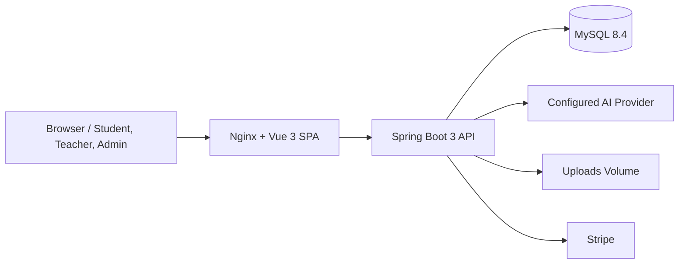

# AI-Powered Interactive Chinese Learning Platform

面向年轻学习者的中文学习平台，包含学生、教师与管理员流程，以及可配置的 AI 学习辅助功能。

## 架构



## 技术栈

| 层         | 技术                                                       |
| ---------- | ---------------------------------------------------------- |
| Frontend   | Vue 3, TypeScript, Pinia, Vue Router, Vite                 |
| Backend    | Java 21, Spring Boot 3.5, Spring Security, Spring Data JPA |
| Data       | MySQL 8.4, Flyway                                          |
| Operations | Docker Compose, Actuator, Micrometer/Prometheus            |

## 已设置的生产安全基线

- AI 文本生成的外部 HTTP 调用不再包在长数据库事务内；推荐上下文仅在短只读事务中加载；AI 音频/图像文件复制也在事务外执行，仅元数据落库使用短事务。
- AI 真实供应商调用有用户级速率限制，默认每分钟 10 次、每天 100 次；多实例部署前应迁移到共享限流存储。
- 密码重置与教师审核邮件只在事务成功提交后由有界异步执行器投递，SMTP 延迟不会占用业务事务。当前队列为进程内 best-effort，要求跨重启可靠投递时需升级为持久化 outbox/队列。
- 常用平台设置、商务设置和公开目录查询使用 Caffeine 五分钟缓存。
- 后端与前端静态服务均发送 CSP 等安全响应头，CORS 方法与请求头使用显式允许列表。
- 登录和匿名认证端点的限流阈值可配置，并由有界 Caffeine 存储避免容量驱逐全表扫描。
- Hikari 池、优雅关闭超时、AI 限额均可通过环境变量配置。
- AI provider latency 指标已通过 Micrometer 记录；Prometheus 端点默认不对公网暴露。

## 本地运行

依赖：Java 21、Node.js 22、Docker Desktop 或可访问的 MySQL 8.4。

启动数据库和后端：

```powershell
cd backend
Copy-Item .env.example .env
docker compose --env-file .env up -d
.\mvnw.cmd spring-boot:run
```

将 `backend/.env` 中的变量设置到 IDE 运行配置或当前终端环境；真实 AI 和支付默认应保持关闭或使用测试凭据。

启动前端：

```powershell
cd frontend
npm ci
npm run dev
```

## 测试与构建

```powershell
cd backend
.\mvnw.cmd test

cd ..\frontend
npm ci
npm run build
```

## 容器部署

根目录的 `docker-compose.prod.yml` 构建后端 Java 运行镜像及 Nginx 前端镜像，并启动 MySQL。创建部署配置并填写强密码、HTTPS URL 与供应商密钥：

```powershell
Copy-Item .env.prod.example .env.prod
docker compose --env-file .env.prod -f docker-compose.prod.yml up --build -d
```

生产配置会 fail-fast：示例文件中的密码/密钥空值必须填入；`JWT_SECRET` 不得为占位文本；`AI_ENABLE_REAL_PROVIDER=true` 且有效 AI 密钥必须配置；`SMTP_ENABLED=true` 且可用的 SMTP/密码重置 HTTPS 地址必须配置。否则容器或应用拒绝启动，避免弱签名令牌、假 AI 响应或静默丢弃密码重置邮件。

Compose 还将 Nginx 前端代理固定在内部网络地址，并把该地址配置为后端唯一可信的转发代理；Nginx 会覆盖而非追加客户端提供的 `X-Forwarded-For`，使登录和匿名认证限流按不可伪造的原始客户端 IP 生效。覆盖 `FRONTEND_PROXY_IP` 时，必须保持它属于 `APP_NETWORK_SUBNET`，并同步覆盖 `APP_SECURITY_FORWARDED_TRUSTED_PROXIES`。

本配置使用持久化卷保存上传文件，适用于单实例部署。水平扩展前，必须将上传存储替换为 S3 兼容对象存储，并将 AI 限流迁移到 Redis 或其他共享存储。

## 运维

- 健康检查：`/actuator/health`。
- Prometheus：在受保护的内部采集路径上设置 `MANAGEMENT_EXPOSED_ENDPOINTS=health,info,prometheus`。
- 关键观察项：`aichinese.ai.provider.duration`、HTTP 错误率、Hikari 活跃连接数、支付失败率。
- 生产部署应由托管数据库备份或经过演练的备份/恢复流程保护数据。

## 数据库迁移约定

`V1__consolidated_schema.sql` 是当前唯一的合并基线迁移，包含表、索引、约束、种子数据、refresh token 会话、共享 AI 限流计数和全文搜索索引。项目在正式生产冻结前，已接受的结构修改都折叠回这个单一 V1；冻结并部署到长期生产数据库后，才通过明确的 baseline/squash 流程建立新的迁移策略。

## 文档

- [生产就绪审计核验与整改记录](docs/PRODUCTION_READINESS_AUDIT_ZH.md)
- [最终整改状态](docs/FINAL_REMEDIATION_STATUS_ZH.md)
- [贡献与迁移规则](CONTRIBUTING.md)
- [安全政策](SECURITY.md)
- [变更记录](CHANGELOG.md)
