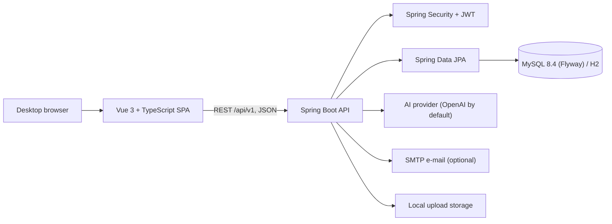

# AI-Powered Interactive Chinese Learning Platform for Young Adults in Malaysia

**MandarinSpark** is a full-stack web application that helps young adult beginners (aged 18–25) in Malaysia learn
Mandarin. It combines a structured learning path, a gamified practice library, free teacher-made classes with live
sessions, a personal learning plan and supplementary AI study support. Teachers are verified and every class is
reviewed by an admin before students can see it.

It was built as a Final Year Project. The interface is available in **English, Bahasa Melayu and Simplified Chinese**
and is designed for desktop browsers (Chrome, Edge, Firefox, Safari; 1024 px wide and up).

## Contents

- [Features](#features)
- [Tech Stack](#tech-stack)
- [Architecture](#architecture)
- [Project Structure](#project-structure)
- [Getting Started](#getting-started)
- [Testing](#testing)
- [License](#license)

## Features

### At a glance

- **Four kinds of users**: public visitors, students, teachers (locked until an admin approves them) and
  administrators, each with their own workspace and sidebar.
- **Learn path**: units of short lessons with a guidebook, review stops and level checkpoints. Answers are checked on
  the server, and wrong answers wait in a Mistakes review.
- **Practice library** of seven types: flashcards, quizzes, listening, character tracing, drag & drop, matching and
  stories.
- **Motivation**: XP from Learn and Practice, a daily goal (10, 20 or 30 XP) that keeps a streak, XP levels and
  badges.
- **Teacher-made classes**: units and lessons with key phrases, a video, practice activities and quizzes, plus
  scheduled live sessions. Classes are free to join.
- **Personal learning plan** built from the student's goal, pace and an adaptive level check.
- **AI Helper** for extra practice: a conversation partner, a tutor, quizzes, stories, and pronunciation and
  handwriting feedback. AI never gives XP or marks.
- **Admin review and oversight**: teacher verification, class review, platform content, AI reports and settings,
  support, analytics and an audit log.

### Public visitors

- Landing page with featured classes and how the platform works.
- Class catalogue with search and filters, and a class page with its teacher, units and lessons.
- Student registration (18+) and teacher registration; sign-in, forgot and reset password, e-mail confirmation.
- Help page with a contact form, Safety centre, Responsible AI guidance, Terms of Service and Privacy Notice.

### Students

| Area            | What students can do                                                                                |
| --------------- | --------------------------------------------------------------------------------------------------- |
| Home            | See the streak week, the next lesson, today's plan and the plan goal                                |
| First-run setup | Choose a goal and pace, take a short adaptive level check and get a personal learning plan          |
| Learn           | Follow the learning path unit by unit in a full-screen lesson player                                |
| Practice        | Play sets of the seven practice types and review waiting mistakes                                   |
| AI Helper       | Talk with Xiaomei, ask SparkBot, make a quick quiz or story, check pronunciation and handwriting    |
| Classes         | Find and join free classes, study lessons (video, key phrases, activities, quizzes), see feedback   |
| Live sessions   | Book a seat, cancel a booking, join from 15 minutes before the start and watch recordings           |
| Progress        | XP level, streak calendar, badges and the learning plan (update the goal or retake the level check) |
| Account & help  | Profile, daily goal, notifications, e-mail and password changes, account deletion, Help & support   |

### Teachers

| Area          | What teachers can do                                                                                 |
| ------------- | ---------------------------------------------------------------------------------------------------- |
| Verification  | Complete a teaching profile, upload verification documents and send the application for approval     |
| Dashboard     | See a to-do list, class numbers, students who need support and upcoming live sessions                |
| Classes       | Create classes, add and reorder units and lessons, write a note to students, archive and restore     |
| Lesson editor | Add key phrases, a video, flashcard / tracing / matching activities and quizzes; preview and submit  |
| Quizzes       | Write questions with hints, learning stages and an optional time limit; generate an AI quiz draft    |
| Live sessions | Schedule sessions (Zoom, Google Meet, Microsoft Teams or another link), edit, cancel, add recordings |
| Students      | Follow each student's progress, quiz results and weak areas, and send feedback                       |

New classes, new lessons and edits to published content go through admin review; students keep seeing the approved
version until a change is approved.

### Administrators

| Area                 | What admins can do                                                                                  |
| -------------------- | --------------------------------------------------------------------------------------------------- |
| Dashboard            | System status, items waiting for a decision and the platform in numbers                             |
| Users                | Search, inspect, deactivate or reactivate accounts, and invite other admins                         |
| Teacher applications | Review documents and approve a teacher or request changes                                           |
| Content              | Review teacher classes and lessons, manage the Learn path, the level check and the Practice library |
| AI                   | Resolve reported AI answers, read the usage log (CSV export) and edit AI notice and safety settings |
| Support              | Answer Help & support requests from students, teachers and visitors                                 |
| Analytics            | Users, sign-ups, learning activity, content and AI usage over 7 or 30 days (CSV export)             |
| Audit log            | Filter and export a record of admin decisions and account, content and support actions              |

### AI Helper

AI support is supplementary practice. It never counts towards XP, marks or assessment and never replaces the
teacher.

1. **Talk with Xiaomei**: a spoken or typed conversation in everyday scenarios, with reply ideas, gentle corrections
   and a summary at the end.
2. **Ask SparkBot**: short explanations for beginners, streamed as they are written.
3. **Quick quiz**: one to five multiple-choice questions on any topic.
4. **Story**: a short story with pinyin, a translation, key words and comprehension questions.
5. **Pronunciation & handwriting**: a practice score for a voice recording or a photo of handwriting.

AI also suggests the wording of a student's learning plan (the plan itself is built by rules) and drafts quiz
questions that teachers review before saving.

Responsible AI safeguards:

- Every AI answer shows an "AI" label and the admin's AI notice, and can be reported to the admins.
- Personal data typed by the user (e-mails, phone numbers, IC-like numbers) is removed before a request is sent, and
  names and account details are never sent.
- Recordings and photos are read in memory and never stored; only the score is kept.
- Per-minute and per-day usage limits, a sensitive-word filter and an AI safety check.
- Real AI calls are off unless they are switched on in the configuration; without them the app still works and says
  that AI is unavailable.

### Security and privacy

- JWT access tokens with rotating HttpOnly refresh-token cookies.
- Role-based access on every route and endpoint, and an approval gate for teacher tools.
- Rate limiting on sign-in, registration and password reset.
- Quiz and activity answers checked on the server; answer keys are never sent to the browser in advance.
- Upload type and size checks, security headers, and an audit log of important actions.

## Tech Stack

| Layer          | Technologies                                                                                      |
| -------------- | ------------------------------------------------------------------------------------------------- |
| Frontend       | Vue 3 (Composition API), TypeScript, Vite, Vue Router, Pinia, Vue I18n, Axios, Lucide icons       |
| Backend        | Java 21, Spring Boot 3.5, Spring Web, Spring Security with JWT (jjwt), Spring Data JPA, Hibernate |
| Database       | MySQL 8.4 with Flyway migrations; H2 for the demo and the tests                                   |
| AI             | OpenAI Responses API by default (DeepSeek or any OpenAI-compatible API also supported)            |
| Other services | SMTP e-mail (optional), Sentry error monitoring (optional), Caffeine cache                        |
| API docs       | SpringDoc OpenAPI and Swagger UI                                                                  |
| Testing        | JUnit 5, Spring Boot Test, Mockito, Vitest, Vue Test Utils, Playwright                            |
| Code quality   | ESLint, Prettier, vue-tsc                                                                         |
| Tooling        | Maven Wrapper, npm, Docker Compose (local MySQL), GitHub Actions                                  |

## Architecture



- The frontend is a single-page app. Each role has its own pages and sidebar, and route guards check the role
  before a page opens.
- The backend is a REST API organised by module (learn, classes, AI, plan, account, admin, support). Controllers
  handle HTTP, services hold the business rules, and repositories access the database.
- Every response uses one envelope (`success`, `message`, `data`). Swagger UI documents the API at
  `/swagger-ui.html`.

## Project Structure

```text
.
|-- backend/                  Spring Boot API (Java 21, Maven Wrapper)
|   `-- src/main/java/com/example/aichinese/
|       |-- controller/       REST endpoints
|       |-- service/          Business logic by module
|       |-- entity/           JPA entities
|       |-- repository/       Spring Data repositories
|       |-- dto/              Request and response types
|       |-- security/         JWT and rate limiting
|       `-- config/           Configuration and seed data
|-- frontend/                 Vue 3 single-page app
|   |-- src/pages/            Public, student, teacher and admin pages
|   |-- src/components/       Shared and module components
|   |-- src/api/              API clients
|   |-- e2e/                  Playwright end-to-end tests
|   `-- DESIGN_SYSTEM.md      Design tokens and UI rules
|-- scripts/local.ps1         Start / stop script for the Windows demo
|-- Start FYP.cmd             One-click Windows demo
`-- .github/workflows/        Continuous integration
```

## Getting Started

**Requirements:** Java 21 and Node.js 22. Docker Desktop (or a local MySQL 8.4) is only needed for the MySQL setup.

### Option 1: One-click Windows demo

Double-click `Start FYP.cmd`. It builds and starts the backend and the frontend with demo data, then opens
`http://127.0.0.1:5174`. The data is kept in `.local/data/`, and the generated sign-in passwords are written to
`.local/admin.env`. `Stop FYP.cmd` stops it.

### Option 2: Demo with an in-memory database

```powershell
cd backend
$env:DEFAULT_ADMIN_EMAIL = "admin@fyp.local"
$env:DEFAULT_ADMIN_PASSWORD = "<choose-a-password>"
.\mvnw.cmd spring-boot:run "-Dspring-boot.run.profiles=demo"
```

In a second terminal:

```powershell
cd frontend
npm ci
npm run dev
```

Open `http://localhost:5174`. The demo profile seeds sample classes, progress and these accounts:

| Role              | E-mail                | Password                                            |
| ----------------- | --------------------- | --------------------------------------------------- |
| Student           | `student@fyp.local`   | `DEMO_STUDENT_PASSWORD` (default `DemoStudent123!`) |
| Teacher           | `teacher@fyp.local`   | `DEMO_TEACHER_PASSWORD` (default `DemoTeacher123!`) |
| Teacher applicant | `applicant@fyp.local` | `DEMO_TEACHER_PASSWORD`                             |
| Admin             | `DEFAULT_ADMIN_EMAIL` | `DEFAULT_ADMIN_PASSWORD`                            |

### Option 3: Local development with MySQL

```powershell
cd backend
docker compose up -d
$env:DB_USERNAME = "aichinese_app"
$env:DB_PASSWORD = "<the password from your backend/.env>"
$env:DEFAULT_ADMIN_EMAIL = "admin@example.com"
$env:DEFAULT_ADMIN_PASSWORD = "<choose-a-password>"
.\mvnw.cmd spring-boot:run "-Dspring-boot.run.profiles=local"
```

Then start the frontend as in Option 2. Flyway creates the schema on the first start.

### Configuration

All backend settings are environment variables, listed with examples in `backend/.env.example`; the frontend's are
in `frontend/.env.example`. To use real AI, set `AI_ENABLE_REAL_PROVIDER=true` and `AI_API_KEY`. E-mail sending
needs `SMTP_ENABLED=true` and the SMTP settings.

## Testing

```powershell
# Backend unit and integration tests (in-memory H2)
cd backend
.\mvnw.cmd test

# Frontend checks, unit tests, build and end-to-end tests
cd frontend
npm run lint
npm run typecheck
npm run test:unit
npm run build
npm run test:e2e
```

The end-to-end tests start their own backend (demo profile, port 8185) and frontend (port 5185). Run
`npx playwright install chromium` once on a new machine. GitHub Actions runs the same checks on every push, plus a
MySQL 8.4 migration test.

## License

No open-source license is included. The project is identified as `Proprietary - UPM Final Year Project`; confirm your
institution's requirements before reusing this code beyond academic demonstration.
