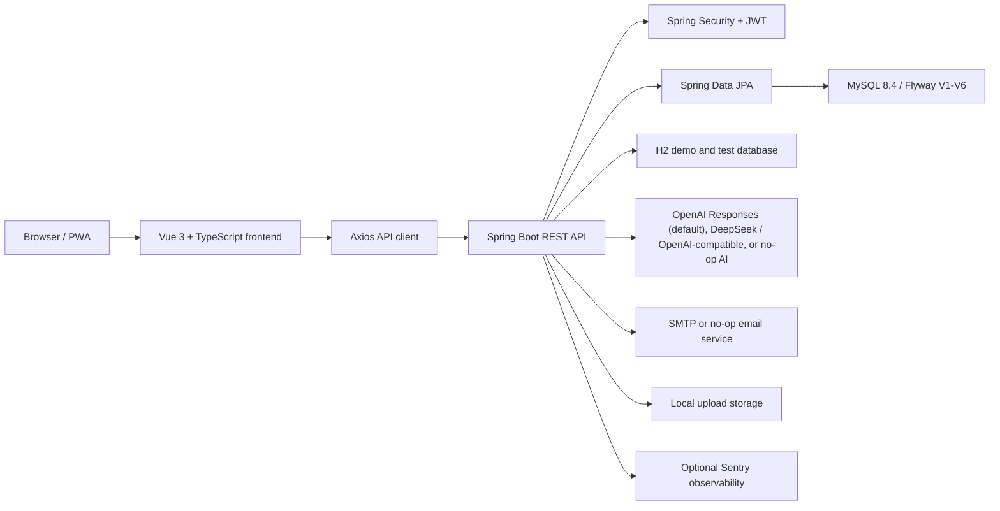

# AI-Powered Interactive Chinese Learning Platform for Young Adults in Malaysia

**MandarinSpark** (the short product name used in the UI) is a full-stack web application for young adult Mandarin
beginners aged 18–25 in Malaysia. It was built as a Final Year Project and combines teacher-authored course content,
live and recorded learning, interactive practice, quizzes with hints and learning stages, progress and mastery
tracking, and supplementary AI study support, with an admin content-review workflow so that learners only see approved
material.

The platform has three signed-in roles plus a public visitor:

- **Public visitors** browse the course catalogue (course, module and lesson summaries only), read the Terms, Privacy
  notice and Responsible AI guidance, and register as a student or teacher.
- **Students** study published lessons, recorded videos and live classes, practise with six types of activities and
  quizzes, use the AI helper, upload pronunciation and handwriting practice for feedback, and track their progress.
- **Teachers** (once approved by an admin) author courses, modules, lessons, quizzes and practice activities, submit
  them for review, run live classes, upload recorded videos, follow their students' progress and mastery, and review
  practice submissions with written feedback.
- **Administrators** approve teachers, review and publish (or reject) submitted content, manage the activity library,
  moderate content and AI-response reports, and manage users, platform settings, analytics and audit logs.

All published learning content is free for every signed-in student. The system has no commerce features: no prices,
carts, checkout, payments or payouts.

The project can run as a normal full-stack application with MySQL, as a persistent Windows desktop demo with
file-backed H2, as an in-memory H2 backend demo, or as a frontend-only preview with no backend.

## Table of Contents

- [Project Highlights](#project-highlights)
- [Feature Overview](#feature-overview)
- [AI Features](#ai-features)
- [Content Review Workflow](#content-review-workflow)
- [Architecture](#architecture)
- [Tech Stack](#tech-stack)
- [Repository Structure](#repository-structure)
- [Prerequisites](#prerequisites)
- [Quick Start Options](#quick-start-options)
- [Backend Setup](#backend-setup)
- [Frontend Setup](#frontend-setup)
- [Environment Variables](#environment-variables)
- [API Overview](#api-overview)
- [Data and Storage](#data-and-storage)
- [Security and Privacy](#security-and-privacy)
- [Testing and Quality Checks](#testing-and-quality-checks)
- [Alignment with the Project Documents](#alignment-with-the-project-documents)
- [Production Notes](#production-notes)
- [Troubleshooting](#troubleshooting)
- [License](#license)

## Project Highlights

- Role-based platform with student, teacher and admin workspaces and a public catalogue.
- JWT authentication with short-lived access tokens and rotating HttpOnly refresh-token cookies; account settings
  (profile, preferred language, change password) for every role.
- Teacher-authored content (courses, modules, lessons, quizzes, six practice-activity types) published only through an
  admin review workflow: Draft → Submitted → Published / Rejected → Archived.
- Teacher approval gate: pending or rejected teachers can only use the dashboard shell, their profile and the
  verification pages.
- Scaffolded practice: optional learning stage (Guided, Scaffolded, Independent) on quizzes and activities, and
  teacher-written quiz hints revealed one at a time on request (not offered in Independent quizzes).
- Server-scored quizzes and activities: answer keys are never sent to the browser before an attempt.
- Per-lesson mastery (Not started, In progress, Completed, Mastered) for students and their teachers.
- Supplementary AI helper: OpenAI Responses API with `gpt-5.6-luna` by default, behind a configurable provider
  service, disabled unless `AI_ENABLE_REAL_PROVIDER=true`.
- Practice submissions: pronunciation recordings and handwriting images are stored for teacher review, with AI
  feedback where the configured model supports it.
- Notifications page for every role, plus audit logs for review, moderation and account actions.
- Interface in English, Bahasa Melayu and Simplified Chinese (`en`, `ms`, `zh-CN`).
- Responsible AI guidance page, AI disclaimer and "AI-assisted" label on every AI output, and a report button for
  every AI output type.
- Optional SMTP email (password reset), optional Sentry on frontend and backend, PWA support.
- Local demo paths that need no AI key, SMTP server or MySQL.

## Feature Overview

### Public Visitor

| Area               | Capabilities                                                                              |
| ------------------ | ----------------------------------------------------------------------------------------- |
| Landing page       | Product introduction for young adult beginners, featured courses, links to guidance pages |
| Course catalogue   | Browse and filter published courses; course detail shows module and lesson summaries only |
| Account access     | Student registration (18+ confirmation), teacher registration, sign-in, refresh, logout   |
| Password recovery  | Forgot-password and reset-password flows with URL/token hygiene                           |
| Guidance and legal | Responsible AI guidance, Terms of service, Privacy notice (academic prototype, PDPA 2010) |

### Student Workspace

| Area                 | Capabilities                                                                                          |
| -------------------- | ----------------------------------------------------------------------------------------------------- |
| Home                 | Progress summary, unfinished lessons, rule-based (non-AI) recommended next step                       |
| Learn                | Lesson body with Chinese and Pinyin, recorded videos, lesson quizzes, mastery chip, content-viewed    |
| Practice             | Flashcards, matching, drag-and-drop, listening, tracing and short-story players, ordered by stage     |
| Quiz                 | All question types, hints on request, full result review, unlimited retakes, wrong-answer review      |
| Classes              | Live class list, enrol / cancel (capacity enforced), join link only inside the joining window         |
| Practice submissions | Record or upload pronunciation audio and handwriting images, view AI and teacher feedback             |
| Progress             | Per-lesson completion, best quiz percentage, mastery and weak areas                                   |
| Achievements/Rewards | Points history, streaks, levels and badges earned from real activity                                  |
| AI helper            | The five AI functions plus pronunciation and writing feedback, each with disclaimer and report button |
| Profile, account     | Learning profile and teacher feedback; display name, preferred language and password                  |
| Notifications        | List, unread/read filter, mark read, mark all read                                                    |

### Teacher Workspace

| Area                   | Capabilities                                                                                                 |
| ---------------------- | ------------------------------------------------------------------------------------------------------------ |
| Dashboard              | Teaching overview and content status (empty shell until the teacher is approved)                             |
| Content                | Courses, modules, lessons, quizzes and questions (with hints and stages); submit for review; rejection notes |
| AI drafts              | Generate an unsaved AI quiz or story draft, review and edit it, then save it through the normal workflow     |
| Practice activities    | Create and manage own flashcards, matching, listening, tracing, drag-and-drop and story activities           |
| Classes                | Create, update, reschedule and cancel live classes (Zoom, Google Meet, Microsoft Teams, other); enrolments   |
| Recorded videos        | Upload, update, archive and stream lesson videos; view video progress                                        |
| Students               | Roster with lesson mastery, weak areas and "needs support" reasons (low quiz average, inactivity)            |
| Feedback               | Written feedback to students, including review of practice submissions                                       |
| Profile, verification  | Public teaching profile, verification documents, resubmission after rejection                                |
| Notifications, account | Notifications page; display name, preferred language and password                                            |

### Admin Workspace

| Area                    | Capabilities                                                                                               |
| ----------------------- | ---------------------------------------------------------------------------------------------------------- |
| Dashboard               | Platform-wide user, content and AI-usage summary                                                           |
| Users                   | Search users, inspect students and teachers, activate or deactivate accounts                               |
| Teacher verification    | Review applications, download documents, approve or reject teachers                                        |
| Content review          | Queue of submitted courses, modules, lessons, quizzes and activities: approve, reject, archive, restore    |
| Content                 | Inspect all content submissions and archive unsuitable content                                             |
| Activity library        | Manage all six activity types                                                                              |
| Moderation              | Hide, unpublish, archive, request revision, restore; AI-response reports; practice submissions (read-only) |
| Analytics               | Student, teacher, content and AI-usage breakdowns                                                          |
| Settings                | Platform name, AI disclaimer text, sensitive-word filter and AI safety check (all enforced)                |
| Audit and notifications | Audit log filtered by date range, action type and actor; notifications page; account settings              |

## AI Features

AI support is supplementary: it never grades learners, never replaces the teacher and is never used for formal
assessment. Every AI output carries a disclaimer, an "AI-assisted" label and a "Report this response" button.

The five AI functions (students, `/api/v1/ai`):

1. **Chat tutor** — conversational Mandarin help, with a streaming variant.
2. **Vocabulary helper** — meaning, Pinyin and example sentences for a word.
3. **Sentence practice** — feedback on a sentence the learner writes.
4. **Quiz generator** — temporary self-practice quizzes (never stored as course content).
5. **Story generator** — short beginner stories.

Prototype-level practice feedback, "subject to provider capability":

- **Pronunciation** (audio upload or recording) — `gpt-5.6-luna` has no audio input, so the response states that AI
  audio feedback is unavailable; the recording is still stored for teacher review.
- **Handwriting** (image upload) — sent as an image input to the OpenAI Responses provider for limited
  AI-assisted feedback (not a score). The Chat Completions-compatible alternatives report that image input is not
  supported.

Both create a practice submission that an approved teacher can review and answer with written feedback.

Teacher AI drafts (`/api/v1/teachers/ai`, approved teachers only): AI quiz and story drafts are returned unsaved; the
teacher reviews and edits them and saves through the normal content workflow.

Provider configuration:

- Default: `AI_PROVIDER=openai` (OpenAI Responses API), `AI_MODEL_NAME=gpt-5.6-luna`,
  `AI_API_BASE_URL=https://api.openai.com/v1`, requests sent with `store=false`.
- Alternatives behind the same service: `deepseek` and `openai-compatible` (Chat Completions APIs).
- Real calls happen only when `AI_ENABLE_REAL_PROVIDER=true` and a key is configured; otherwise a no-op provider is
  used and the AI helper reports that AI is unavailable.
- Prompts target adult beginners (concise, respectful, HSK 1–2 level, Mandarin learning only) and explain in the
  learner's interface language. Emails, phone numbers and NRIC-like numbers typed by the learner are redacted before
  any text is sent; names, emails and ids are never included. Per-minute and per-day usage limits apply.

## Content Review Workflow

Applies to courses, modules, lessons, quizzes and all six practice-activity types.

| From                 | Action                        | To                                       | Who                                             |
| -------------------- | ----------------------------- | ---------------------------------------- | ----------------------------------------------- |
| (new)                | create                        | DRAFT                                    | teacher/admin                                   |
| DRAFT, REJECTED      | submit (completeness-checked) | SUBMITTED                                | owner teacher                                   |
| SUBMITTED            | approve                       | PUBLISHED                                | admin                                           |
| SUBMITTED, PUBLISHED | reject (reason required)      | REJECTED (teacher can edit and resubmit) | admin                                           |
| PUBLISHED            | teacher edits                 | SUBMITTED (hidden until re-approved)     | owner teacher                                   |
| any except ARCHIVED  | archive                       | ARCHIVED (learner progress kept)         | admin (teachers: own courses, modules, lessons) |
| ARCHIVED             | restore                       | PUBLISHED                                | admin                                           |

Students only see PUBLISHED items whose parent module/lesson is also PUBLISHED and whose teacher is approved and
active. Every decision notifies the teacher (with the reason), submissions notify admins, and every step is audited.

## Architecture



### Frontend Architecture

- Vue 3 Composition API with TypeScript, custom components and Lucide icons.
- Vue Router owns public, student, teacher, admin, unauthorized and not-found routes, with role guards.
- Pinia stores manage auth and UI state.
- The Axios wrapper (`src/api/http.ts`) centralises the API base URL, bearer token, refresh-token recovery and auth
  invalidation; `src/api/services.ts` is the typed API layer.
- `src/config/navigation.ts` is the single source of truth for public and sidebar navigation.
- `src/config/env.ts` validates build-time environment variables.
- `src/demo/` holds typed preview fixtures used only in preview mode without a real session.
- `src/plugins/i18n.ts` provides shared EN/MS/zh-CN labels; each page loads its own message bundle.
- `src/plugins/pwa.ts` registers the service worker; `src/plugins/observability.ts` starts Sentry only when a DSN is
  configured and scrubs sensitive data.

### Backend Architecture

- Spring Boot 3.5 on Java 21; Spring Security with JWT access tokens and refresh-token cookies.
- Spring Data JPA; Flyway manages the MySQL schema (Hibernate `validate`); H2 for demo and test profiles.
- Services cover auth and accounts, public catalogue, learning and progress, content and content review, activities,
  quizzes, live and recorded learning, AI, practice submissions, feedback, moderation, analytics, notifications,
  storage, email and audit.
- `ContentVisibilityPolicy` is the single rule set for what students and visitors can see;
  `ApprovedTeacherInterceptor` enforces the teacher approval gate on `/api/v1/teachers/**`.
- Provider abstractions with no-op implementations for AI and email.
- Startup guards validate risky production configuration (JWT secret, AI provider, deployment topology).
- SpringDoc exposes OpenAPI JSON at `/v3/api-docs` and Swagger UI at `/swagger-ui.html`; both are switched off
  under the `prod` / `production` profile.

## Tech Stack

| Layer                      | Technology                                                                             |
| -------------------------- | -------------------------------------------------------------------------------------- |
| Frontend framework         | Vue 3, TypeScript, Vite                                                                |
| Frontend UI                | Custom Vue components, Lucide icons                                                    |
| Frontend state and routing | Pinia, Vue Router                                                                      |
| Frontend i18n              | Vue I18n (en, ms, zh-CN)                                                               |
| Frontend HTTP              | Axios                                                                                  |
| Frontend tests             | Vitest, Vue Test Utils, Testing Library, jsdom, Playwright                             |
| Frontend quality           | ESLint, Prettier, vue-tsc                                                              |
| PWA                        | vite-plugin-pwa, Workbox                                                               |
| Backend framework          | Java 21, Spring Boot 3.5                                                               |
| Backend security           | Spring Security, JWT, refresh cookies, rate limiting                                   |
| Backend persistence        | Spring Data JPA, Hibernate                                                             |
| Database                   | MySQL 8.4 for local/runtime, H2 for demo/test                                          |
| Migration                  | Flyway (V1–V6)                                                                         |
| API docs                   | SpringDoc OpenAPI, Swagger UI                                                          |
| AI integration             | OpenAI Responses API (`gpt-5.6-luna`) by default; DeepSeek or OpenAI-compatible; no-op |
| Email                      | SMTP provider, no-op provider                                                          |
| Observability              | Sentry frontend and backend integrations (optional)                                    |
| Containers                 | Docker Compose for local MySQL                                                         |

## Repository Structure

```text
.
|-- .github/workflows/verify.yml   CI: frontend checks, backend tests, MySQL 8.4 migration test
|-- Start FYP.cmd / Stop FYP.cmd   One-click Windows desktop demo
|-- scripts/local.ps1              Start / Stop / Status script used by the .cmd files
|-- backend/
|   |-- .env.example
|   |-- docker-compose.yml         Local MySQL 8.4 on host port 3307
|   |-- mvnw / mvnw.cmd
|   |-- pom.xml
|   `-- src/
|       |-- main/java/com/example/aichinese/
|       |   |-- config/          Security, providers, OpenAPI, seeds, approval interceptor, runtime guards
|       |   |-- controller/      REST controllers (public, auth, account, student, teacher, admin, AI)
|       |   |-- dto/             Request and response contracts
|       |   |-- entity/          JPA entities and enums
|       |   |-- exception/       Global API error handling
|       |   |-- mapper/          Entity-to-DTO mapping helpers
|       |   |-- repository/      Spring Data repositories
|       |   |-- security/        JWT, user details, auth entry points, rate limiting
|       |   |-- service/         Business workflows, AI providers, storage, email
|       |   `-- util/            Shared utilities (redaction, language codes, text)
|       |-- main/resources/
|       |   |-- application.yml
|       |   |-- application-local.yml
|       |   |-- application-demo.yml
|       |   |-- application-desktop.yml
|       |   `-- db/migration/    V1__ ... V6__ Flyway migrations
|       `-- test/                Backend unit and integration tests
|
|-- frontend/
|   |-- .env.example
|   |-- package.json
|   |-- playwright.config.ts
|   |-- vite.config.ts
|   |-- e2e/                     Playwright browser tests
|   `-- src/
|       |-- api/                 Axios client and typed API wrappers
|       |-- components/          Activities, AI, content, dashboard, layout, learning, practice, public, submissions, teacher
|       |-- composables/         Reusable resource/loading helpers
|       |-- config/              Environment and navigation config
|       |-- demo/                Typed preview fixtures
|       |-- layouts/             Public and dashboard layouts
|       |-- pages/               Public, student, teacher, admin, shared and system pages
|       |-- plugins/             i18n (and message bundles), PWA, observability
|       |-- router/              Route definitions and guards
|       |-- stores/              Pinia stores
|       |-- styles/              Global CSS
|       |-- types/               Shared frontend API types
|       `-- utils/               Formatting, locale, storage, role, URL, download and security helpers
|
`-- README.md
```

## Prerequisites

- Java 21 (Maven is not needed globally; the backend includes Maven Wrapper).
- Node.js 22 (`engines.node` is `>=22 <23`) and npm.
- Docker Desktop, or a local MySQL 8.4, for the MySQL workflow.

Useful extras: Git, an IDE (IntelliJ IDEA or VS Code), and Swagger UI / Postman for manual API calls.

## Quick Start Options

### Option 0: One-Click Windows Desktop Demo

On Windows with Java 21 and Node.js 22 installed, open `Start FYP.cmd` in the repository root. It runs
`scripts/local.ps1 -Action Start`, which builds the backend, installs frontend dependencies if needed, starts both
services, waits for the health checks and opens `http://127.0.0.1:5174`. `Stop FYP.cmd` stops only the processes this
project started. For a status check, run:

```powershell
powershell -File scripts/local.ps1 -Action Status
```

The desktop demo uses the `demo,desktop` profiles. Its H2 database is stored in `.local/data/`, so accounts and
progress survive a restart. On the first start the app creates one admin, one approved teacher and one student, plus a
published beginner module with three lessons (self-introduction, numbers and prices, ordering food) grouped into one
published course. The login emails are `admin@fyp.local`, `teacher@fyp.local` and `student@fyp.local`; their randomly
generated passwords are written to `.local/admin.env`. Keep that file private. Logs and process ids also live under
`.local/`, which Git ignores. Real AI and SMTP are off in this mode.

### Option 1: Frontend-Only Preview

Use this to present the UI without a backend or database.

```powershell
cd frontend
Copy-Item .env.example .env.local
```

Edit `frontend/.env.local`:

```text
VITE_API_BASE_URL=/api/v1
VITE_USE_DEMO_DATA=true
VITE_ENABLE_PREVIEW_MODE=true
```

Install and start Vite:

```powershell
npm ci
npm run dev
```

Open `http://localhost:5174/auth` and use the Preview Student, Preview Teacher or Preview Admin buttons. Preview mode
uses the typed fixtures in `frontend/src/demo/` and is read-only.

### Option 2: Full-Stack Demo with In-Memory H2

Use this to run the backend API without MySQL.

```powershell
cd backend
$env:DEFAULT_ADMIN_EMAIL = "admin@example.com"
$env:DEFAULT_ADMIN_PASSWORD = "<choose-a-strong-password>"
$env:DEMO_TEACHER_PASSWORD = "<choose-a-strong-password>"
$env:DEMO_STUDENT_PASSWORD = "<choose-a-strong-password>"
.\mvnw.cmd spring-boot:run "-Dspring-boot.run.profiles=demo"
```

The `demo` profile binds to `127.0.0.1:8080`, uses an in-memory H2 database (schema created and dropped on each run,
Flyway disabled), keeps real AI and SMTP disabled, and seeds the same demo teacher, student and beginner content as
Option 0. If `DEMO_TEACHER_PASSWORD` / `DEMO_STUDENT_PASSWORD` are not set, the built-in development defaults in
`DemoContentSeeder` are used.

Then start the frontend in a second terminal:

```powershell
cd frontend
npm ci
npm run dev
```

Open `http://localhost:5174`.

### Option 3: Local Development with MySQL

The closest local workflow to a real runtime.

```powershell
cd backend
docker compose up -d
```

```powershell
cd backend
$env:DB_USERNAME = "aichinese_app"
$env:DB_PASSWORD = "replace-with-a-strong-application-db-password"
$env:JWT_SECRET = "local-development-secret-with-at-least-32-characters"
$env:DEFAULT_ADMIN_EMAIL = "admin@example.com"
$env:DEFAULT_ADMIN_PASSWORD = "<choose-a-strong-password>"
.\mvnw.cmd spring-boot:run "-Dspring-boot.run.profiles=local"
```

On start-up Flyway applies V1–V6 and Hibernate validates the schema. Then run the frontend (`npm ci`, `npm run dev`
in `frontend/`) and open `http://localhost:5174`.

The `local` profile binds to `127.0.0.1` and has a development-only JWT fallback secret, so `JWT_SECRET` is optional
there. It is not a production configuration.

## Backend Setup

### Backend URLs

| Purpose         | URL                                     |
| --------------- | --------------------------------------- |
| API base        | `http://localhost:8080/api/v1`          |
| Health check    | `http://localhost:8080/api/v1/health`   |
| Swagger UI      | `http://localhost:8080/swagger-ui.html` |
| OpenAPI JSON    | `http://localhost:8080/v3/api-docs`     |
| Actuator health | `http://localhost:8080/actuator/health` |

### Backend Commands

Windows PowerShell:

```powershell
cd backend
.\mvnw.cmd test
.\mvnw.cmd spring-boot:run "-Dspring-boot.run.profiles=local"
.\mvnw.cmd clean package
```

macOS or Linux:

```bash
cd backend
./mvnw test
./mvnw spring-boot:run -Dspring-boot.run.profiles=local
./mvnw clean package
```

### MySQL Commands

Run these from `backend/`:

```powershell
docker compose up -d
docker compose logs -f mysql
docker compose down
```

To wipe the local database volume (deletes all local MySQL data):

```powershell
docker compose down -v
```

## Frontend Setup

The Vite dev server runs on `http://localhost:5174` with `strictPort: true` and proxies `/api/v1` to
`http://127.0.0.1:8080`, so the default API base can stay `/api/v1` during local development.

### Frontend Commands

```powershell
cd frontend
npm ci
npm run dev
npm run lint
npm run format:check
npm run typecheck
npm run test:unit
npm run test:e2e
npm run build
npm run preview
```

### Frontend Environment

Create `frontend/.env.local` only to override the defaults:

```text
VITE_API_BASE_URL=/api/v1
VITE_USE_DEMO_DATA=false
VITE_ENABLE_PREVIEW_MODE=false
VITE_SENTRY_DSN=
VITE_APP_RELEASE=
VITE_GIT_SHA=
```

## Environment Variables

`backend/.env.example` and `frontend/.env.example` are the templates. Defaults come from
`backend/src/main/resources/application.yml`. Do not commit `.env`, `.env.local`, secrets, upload folders, build
outputs or dependency folders.

### Backend Core

| Variable                                                                                                                               | Purpose                                        | Default / typical local value               |
| -------------------------------------------------------------------------------------------------------------------------------------- | ---------------------------------------------- | ------------------------------------------- |
| `SERVER_PORT`                                                                                                                          | Backend HTTP port                              | `8080`                                      |
| `DB_HOST`, `DB_PORT`, `DB_NAME`                                                                                                        | MySQL connection                               | `localhost`, `3307`, `ai_chinese_learning`  |
| `DB_USERNAME`, `DB_PASSWORD`                                                                                                           | Application database user                      | `aichinese_app`, local strong password      |
| `DB_ROOT_PASSWORD`                                                                                                                     | MySQL root password (Docker Compose only)      | Local strong password                       |
| `DB_MAX_POOL_SIZE`, `DB_MIN_IDLE`, `DB_CONNECTION_TIMEOUT_MS`                                                                          | Hikari pool settings                           | `30`, `2`, `30000`                          |
| `JWT_SECRET`                                                                                                                           | JWT signing secret (plain or `base64:` prefix) | At least 32 characters                      |
| `JWT_EXPIRATION`, `JWT_REFRESH_EXPIRATION`                                                                                             | Access / refresh token lifetime (ms)           | `900000`, `604800000`                       |
| `JWT_REFRESH_COOKIE_NAME`, `JWT_REFRESH_COOKIE_SECURE`, `JWT_REFRESH_COOKIE_SAME_SITE`                                                 | Refresh cookie                                 | `mandarin_spark_refresh`, `false`, `Strict` |
| `LOGIN_MAX_FAILED_ATTEMPTS`, `LOGIN_ATTEMPT_WINDOW_MINUTES`, `LOGIN_LOCK_DURATION_MINUTES`, `LOGIN_MAX_TRACKED_RECORDS`                | Login limiter                                  | `5`, `15`, `15`, `10000`                    |
| `REGISTER_REQUESTS_PER_WINDOW`, `FORGOT_PASSWORD_REQUESTS_PER_WINDOW`, `PUBLIC_AUTH_WINDOW_MINUTES`, `PUBLIC_AUTH_MAX_TRACKED_RECORDS` | Public auth limiter                            | `100`, `10`, `15`, `10000`                  |
| `APP_SECURITY_FORWARDED_TRUSTED_PROXIES`                                                                                               | Proxies allowed to send `X-Forwarded-For`      | empty                                       |
| `DEFAULT_ADMIN_EMAIL`, `DEFAULT_ADMIN_PASSWORD`                                                                                        | Optional seeded admin account                  | empty                                       |
| `DEMO_TEACHER_PASSWORD`, `DEMO_STUDENT_PASSWORD`                                                                                       | Demo account passwords (`demo` profile only)   | set by `scripts/local.ps1`                  |
| `FRONTEND_BASE_URL`                                                                                                                    | Base for password-reset links                  | `http://localhost:5174`                     |
| `APP_CORS_ALLOWED_ORIGINS`                                                                                                             | Allowed frontend origins                       | Local Vite origins                          |
| `APP_DEFAULT_TIME_ZONE`                                                                                                                | Platform time zone                             | `Asia/Singapore`                            |
| `APP_DEPLOYMENT_MODE`, `APP_SHARED_AUTH_RATE_LIMITING_ENABLED`, `APP_LOCAL_STORAGE_MULTI_INSTANCE_ACKNOWLEDGED`                        | Deployment topology guard                      | `single-instance`, `false`, `false`         |
| `ASYNC_CORE_POOL_SIZE`, `ASYNC_MAX_POOL_SIZE`, `ASYNC_QUEUE_CAPACITY`                                                                  | Async executor                                 | `2`, `4`, `100`                             |
| `SHUTDOWN_TIMEOUT`                                                                                                                     | Graceful shutdown timeout                      | `30s`                                       |
| `MANAGEMENT_EXPOSED_ENDPOINTS`                                                                                                         | Actuator endpoints                             | `health,info`                               |
| `FYP_DATA_DIR`                                                                                                                         | H2 file location for the `desktop` profile     | `./.local/data`                             |

### Backend AI

| Variable                  | Purpose                                                     | Default                     |
| ------------------------- | ----------------------------------------------------------- | --------------------------- |
| `AI_PROVIDER`             | `openai` (Responses API), `deepseek` or `openai-compatible` | `openai`                    |
| `AI_API_BASE_URL`         | Provider API base (HTTPS, or HTTP on loopback only)         | `https://api.openai.com/v1` |
| `AI_API_KEY`              | Provider API key                                            | empty                       |
| `AI_MODEL_NAME`           | Model name                                                  | `gpt-5.6-luna`              |
| `AI_ENABLE_REAL_PROVIDER` | Must be `true` to call the real provider                    | `false`                     |
| `AI_TIMEOUT_SECONDS`      | Provider request timeout                                    | `30`                        |
| `AI_MAX_OUTPUT_TOKENS`    | Output token cap                                            | `1200`                      |
| `AI_REQUESTS_PER_MINUTE`  | Per-user per-minute AI limit                                | `10`                        |
| `AI_REQUESTS_PER_DAY`     | Per-user per-day AI limit                                   | `100`                       |

### Backend Email, Uploads and Observability

| Variable                                                                                   | Purpose                                    | Default                               |
| ------------------------------------------------------------------------------------------ | ------------------------------------------ | ------------------------------------- |
| `SMTP_ENABLED`                                                                             | Enables real SMTP sending                  | `false`                               |
| `SMTP_HOST`, `SMTP_PORT`                                                                   | SMTP server                                | empty, `587`                          |
| `SMTP_USERNAME`, `SMTP_PASSWORD`                                                           | SMTP credentials                           | empty                                 |
| `SMTP_FROM`                                                                                | Sender address                             | empty                                 |
| `SMTP_AUTH_ENABLED`, `SMTP_STARTTLS_ENABLED`, `SMTP_STARTTLS_REQUIRED`, `SMTP_SSL_ENABLED` | SMTP options                               | `true`, `true`, `false`, `false`      |
| `SMTP_CONNECTION_TIMEOUT_MS`, `SMTP_TIMEOUT_MS`, `SMTP_WRITE_TIMEOUT_MS`                   | SMTP timeouts                              | `5000`                                |
| `PASSWORD_RESET_BASE_URL`                                                                  | Password-reset link base                   | `${FRONTEND_BASE_URL}/reset-password` |
| `UPLOAD_DIR`                                                                               | Upload directory                           | `./uploads`                           |
| `RECORDED_VIDEO_UPLOAD_DIR`                                                                | Recorded video directory                   | `./uploads/recorded-videos`           |
| `MAX_FILE_SIZE`                                                                            | General upload limit                       | `10MB`                                |
| `MAX_VERIFICATION_DOCUMENT_FILE_SIZE`                                                      | Teacher verification document limit        | `5MB`                                 |
| `MAX_AI_AUDIO_FILE_SIZE`, `MAX_AI_IMAGE_FILE_SIZE`                                         | Pronunciation / handwriting upload limit   | `10MB`                                |
| `MAX_VIDEO_FILE_SIZE`                                                                      | Recorded video and multipart request limit | `100MB`                               |
| `SENTRY_DSN`, `SENTRY_TRACES_SAMPLE_RATE`                                                  | Optional backend Sentry                    | empty, `0.0`                          |
| `APP_ENVIRONMENT`, `APP_RELEASE`                                                           | Sentry environment and release             | `local`, empty                        |

### Frontend

| Variable                            | Purpose                             |
| ----------------------------------- | ----------------------------------- |
| `VITE_API_BASE_URL`                 | API base URL, default `/api/v1`     |
| `VITE_USE_DEMO_DATA`                | Enables typed preview fixtures      |
| `VITE_ENABLE_PREVIEW_MODE`          | Enables the preview persona buttons |
| `VITE_SENTRY_DSN`                   | Optional frontend Sentry DSN        |
| `VITE_APP_RELEASE` / `VITE_GIT_SHA` | Optional release metadata           |

Test-only: `RUN_MYSQL_MIGRATION_TEST=true` enables the MySQL migration test (backend) and
`PLAYWRIGHT_BROWSER_CHANNEL` (for example `chrome`) makes Playwright use an installed browser.

## API Overview

All endpoints are versioned under `/api/v1` and return an `ApiResponse` envelope (`success`, `message`, `data`).

| API group            | Base path                                                | Purpose                                                                                                                                                            |
| -------------------- | -------------------------------------------------------- | ------------------------------------------------------------------------------------------------------------------------------------------------------------------ |
| Health               | `/api/v1/health`                                         | Public health check                                                                                                                                                |
| Auth                 | `/api/v1/auth`                                           | Register student/teacher, login, refresh, current user, logout, forgot/reset password                                                                              |
| Account              | `/api/v1/users/me`                                       | Update profile and preferred language, change password (every role)                                                                                                |
| Public               | `/api/v1/public`                                         | Courses and course detail (summaries only), teacher profile, levels, categories, settings                                                                          |
| Notifications        | `/api/v1/notifications`                                  | List (status filter), unread count, mark read, mark all read                                                                                                       |
| AI (student)         | `/api/v1/ai`                                             | Availability, chat, streaming chat, five AI functions, pronunciation/writing feedback, reports                                                                     |
| Students             | `/api/v1/students`                                       | Dashboard, analytics, lessons, viewed, quizzes, hints, attempts, wrong answers, live classes, videos, progress, rewards                                            |
| Student activities   | `/api/v1/students/activities`                            | Activity feed, activity detail (no answer keys) and server-scored completion                                                                                       |
| Student feedback     | `/api/v1/students/feedback`                              | Teacher feedback received                                                                                                                                          |
| Practice submissions | `/api/v1/{students,teachers,admin}/practice-submissions` | Own list/detail/file; teacher review and feedback; admin read-only                                                                                                 |
| Teachers             | `/api/v1/teachers`                                       | Dashboard, analytics, profile, verification, modules, lessons, courses, quizzes, live classes, videos, students, submit for review                                 |
| Teacher activities   | `/api/v1/teachers/activities`                            | Own practice activities: CRUD for drafts, submit for review                                                                                                        |
| Teacher AI drafts    | `/api/v1/teachers/ai`                                    | Availability, unsaved quiz and story drafts                                                                                                                        |
| Teacher feedback     | `/api/v1/teachers/feedback`                              | Create, list and update feedback (optionally linked to a practice submission)                                                                                      |
| Admin                | `/api/v1/admin`                                          | Dashboard, analytics, users, students, teachers and verification, live classes, content, AI usage logs, notifications, moderation, AI-response reports, audit logs |
| Admin content review | `/api/v1/admin/content-review`                           | Review queue and detail; approve, reject, archive, restore                                                                                                         |
| Admin activities     | `/api/v1/admin/activities`                               | Activity library CRUD and status                                                                                                                                   |
| Admin settings       | `/api/v1/admin/system-settings`                          | Platform settings (`/platform`)                                                                                                                                    |

For protected endpoints in Swagger UI, sign in with `POST /api/v1/auth/login`, copy the returned access token and
paste the raw token into Authorize (Swagger adds the `Bearer` prefix).

## Data and Storage

### Main Domain Areas

- Identity: users, roles, student profiles (optional institution), teacher profiles, verification documents and
  reviews, refresh tokens.
- Learning catalogue: levels, categories, courses (`course_packages`) and course items, modules, lessons.
- Live and recorded learning: live classes, enrolments (with attendance), recorded videos, video progress.
- Practice and assessment: quizzes, questions (with hints), options, attempts and answers (hint use, selected option),
  lesson progress; flashcards, matching games, listening, tracing, drag-and-drop and story activities.
- Practice submissions: pronunciation audio and handwriting images with AI feedback status and teacher review.
- Rewards: badges, student badges, points transactions, daily streaks.
- AI: chat sessions and messages, usage logs and quota counters, AI feedback records, AI-response reports.
- Communication and governance: notifications, teacher feedback, moderation records, audit logs, platform settings.

### Flyway Migrations (MySQL 8.4)

| Migration                                  | What it does                                                                                                                                                                                                        |
| ------------------------------------------ | ------------------------------------------------------------------------------------------------------------------------------------------------------------------------------------------------------------------- |
| `V1__consolidated_schema.sql`              | Baseline schema, indexes, constraints and seed rows (never edited)                                                                                                                                                  |
| `V2__remove_commerce.sql`                  | Drops the commerce tables, price/access-type columns and settings; remaps payment notifications                                                                                                                     |
| `V3__young_adult_alignment.sql`            | Drops age-band columns, renames the report reason, updates platform name/disclaimer, removes unused settings, maps `zh` to `zh-CN`                                                                                  |
| `V4__content_review_workflow.sql`          | Adds `learning_stage` and `rejection_reason`, migrates APPROVED to ARCHIVED, review-queue indexes                                                                                                                   |
| `V5__learner_experience_and_integrity.sql` | Adds `practice_submissions`, quiz hints and hint usage, option-based answers, story answer keys, content-viewed progress, live-class re-enrolment, extra FKs/uniques, utf8mb4 collation                             |
| `V6__badge_alignment.sql`                  | Badge catalogue = the five badges the reward service awards (First Steps, Quiz Star, Lesson Finisher, Streak Explorer, Point Starter) with rule descriptions; retires the never-awarded Quiz Explorer / Daily Spark |

V2–V5 are guarded through `information_schema` so they run on an existing V1 database as well as a fresh install.

### Database Modes

| Mode                 | Profile            | Database              | Schema strategy                          |
| -------------------- | ------------------ | --------------------- | ---------------------------------------- |
| Local/runtime        | `local` or default | MySQL 8.4             | Flyway V1–V6, Hibernate `validate`       |
| Demo backend         | `demo`             | In-memory H2          | Hibernate `create-drop`, Flyway disabled |
| Windows desktop demo | `demo,desktop`     | File-backed H2        | Hibernate `update`, Flyway disabled      |
| Automated tests      | `test`             | Isolated H2 databases | Hibernate `create-drop`, Flyway disabled |

### Upload Storage

Uploads (verification documents, practice submissions) and recorded videos are stored locally by default under
`backend/uploads/` and `backend/uploads/recorded-videos/`, both ignored by Git. Files are streamed only through
authorised endpoints. Configure `UPLOAD_DIR` and `RECORDED_VIDEO_UPLOAD_DIR` for shared or production-like
environments.

## Security and Privacy

- Role-based protection in the frontend router guards and backend Spring Security; teacher approval gate on all
  teaching features.
- Short-lived JWT access tokens and rotating refresh-token cookies (configurable name, `Secure` and `SameSite`).
- Change password verifies the current password, revokes all other sessions and refresh tokens, and is rate-limited.
- Login, registration, forgot-password and reset-password rate limiting; inactive accounts get a distinct "account
  unavailable" message only after a correct password.
- Password-reset token flow with frontend URL cleanup.
- CORS allow-list, secure response headers, trusted-proxy handling for forwarded IPs, upload size limits.
- Content-safety screening of teacher-authored text; sensitive-word filter and AI safety check on AI input and output.
- AI data minimisation: learner-typed identifiers are redacted, no names/emails/ids are sent, requests use
  `store=false`.
- Quiz and activity answer keys stay on the server until an attempt is submitted.
- Learner emails are not exposed in teacher roster, enrolment or video-progress views.
- Sensitive-data redaction in backend logs and frontend Sentry events.
- Audit logs for review, moderation, account and practice-submission actions.

Local safety defaults:

- Real AI calls are disabled unless `AI_ENABLE_REAL_PROVIDER=true`.
- SMTP email is disabled unless `SMTP_ENABLED=true`.
- The `local`, `demo` and desktop profiles bind to `127.0.0.1`.

## Testing and Quality Checks

### Frontend

```powershell
cd frontend
npm run format:check
npm run lint
npm run typecheck
npm run test:unit
npm run test:e2e
npm run build
```

Current results: **89 Vitest files / 392 tests** and **37 Playwright tests**, all passing. Run
`npx playwright install chromium` once on a new machine, or set `PLAYWRIGHT_BROWSER_CHANNEL=chrome` to use an
installed Chrome. The end-to-end tests start an isolated preview server on port 5185 with preview fixtures (not a live
backend).

Unit tests cover the API wrappers and auth refresh, environment validation, navigation, stores, EN/MS/zh-CN message
parity, PWA and Sentry helpers, URL/storage/format/role/locale helpers, activity forms and practice players.
Playwright covers course discovery and detail, language persistence, translated sign-in and recovery, narrow phone
layouts, and student, teacher and admin preview workspaces.

### Backend

```powershell
cd backend
.\mvnw.cmd test
```

Current result: **509 tests, 0 failures, 0 errors, 5 skipped** (the skipped tests are `MySqlMigrationSmokeTests`,
which need a real MySQL and `RUN_MYSQL_MIGRATION_TEST=true`).

Backend tests cover auth, refresh tokens, JWT and rate limiting; account management; security configuration and
headers; the content review workflow and teacher approval gate; content visibility; teacher activities; quiz scoring,
hints and learning stages; activity answer keys and completion; lesson mastery; live and recorded learning; practice
submissions and teacher review; dashboard, analytics and learning aggregation; AI prompts, provider routing (OpenAI
Responses and compatible clients), redaction, safety guard and usage limits; email and upload storage; and schema,
migration, enum, DTO and mapper contracts.

GitHub Actions (`.github/workflows/verify.yml`) runs the frontend checks, the backend test suite and a MySQL 8.4 job
that runs `MySqlMigrationSmokeTests` with `RUN_MYSQL_MIGRATION_TEST=true`.

## Alignment with the Project Documents

This codebase was aligned with the project proposal (the highest authority) and with the revised SRS v2.0 and SDD v2.0.
The revised Proposal, SRS v2.0 and SDD v2.0 are in `../01_Documents_REVISED/`; diagrams are in
`../02_Diagrams_REVISED/`. Main alignment points: no commerce, young adult (18–25) target users, OpenAI Responses API
with `gpt-5.6-luna` as the default AI provider, the content review workflow, teacher-authored activities, practice
submissions with teacher review, hints, learning stages and mastery. The UI uses custom Vue components and Lucide
icons instead of Element Plus; this is recorded as a design change.

**MySQL 8.4 verification (done on 18 October 2026, MySQL Community Server 8.4.11):**

- Fresh database: Flyway applied V1–V6, Hibernate validated the schema and `MySqlMigrationSmokeTests` passed (6/6).
  The backend started with the `local` profile and an API scenario passed (pending teacher blocked with 403, teacher
  approval, Draft → Submitted → Published review, student lesson, hint and quiz attempt 10/10, progress 100%).
  Chinese and Pinyin round-trip correctly (utf8mb4 bytes checked in MySQL).
- Upgrade path: a database created by the original V1 code with legacy data (paid module, cart, payment
  notification, kindergarten age band, `AGE_INAPPROPRIATE` report, language `zh`, APPROVED lesson, empty published
  quiz, a student holding a retired badge) was upgraded V2–V6; all 23 data checks passed, the smoke tests passed and
  the same API scenario passed.
- Fixes found by this run: V5 now suspends `foreign_key_checks` while making ownership foreign-key columns NOT NULL
  (MySQL error 1832), and `MySqlMigrationSmokeTests` now uses a MOCK web environment (the previous NONE context could
  not load the security configuration, so the CI MySQL job could never reach the migration checks).

To repeat the verification on your own machine:

```powershell
cd backend
docker compose up -d
.\mvnw.cmd spring-boot:run "-Dspring-boot.run.profiles=local"
```

Or run the smoke test against that database:

```powershell
cd backend
$env:RUN_MYSQL_MIGRATION_TEST = "true"
$env:DB_USERNAME = "aichinese_app"
$env:DB_PASSWORD = "replace-with-a-strong-application-db-password"
$env:JWT_SECRET = "local-development-secret-with-at-least-32-characters"
.\mvnw.cmd "-Dtest=MySqlMigrationSmokeTests" test
```

## Production Notes

This is an academic prototype, but it includes production-aware safeguards. Before any real deployment:

- Use a managed MySQL 8.4 database and let Flyway apply V1–V6.
- Set a strong `JWT_SECRET` through secret management and `JWT_REFRESH_COOKIE_SECURE=true` behind HTTPS. With the
  `prod` profile the backend refuses to start when `JWT_REFRESH_COOKIE_SECURE` is not `true`
  (`RefreshCookieProductionGuard`); local and demo runs keep the HTTP default `false`.
- Restrict `APP_CORS_ALLOWED_ORIGINS` and set `FRONTEND_BASE_URL` to the deployed frontend.
- With the `prod` profile, the AI guard requires `AI_ENABLE_REAL_PROVIDER=true`, a supported provider, a real key, a
  model name and a public HTTPS `AI_API_BASE_URL`; also review the AI rate limits and monitoring.
- Enable SMTP only with a real sender domain and credentials.
- For more than one backend instance, replace local upload storage with durable shared storage and review the
  deployment topology settings (`APP_DEPLOYMENT_MODE` and related flags).
- Configure Sentry DSNs and release metadata if observability is needed.
- Disable preview mode (`VITE_USE_DEMO_DATA=false`, `VITE_ENABLE_PREVIEW_MODE=false`).

## Troubleshooting

### Frontend port is already in use

The frontend uses port `5174` with `strictPort: true`. Stop the process using that port, or change it in
`frontend/vite.config.ts`. The desktop demo also needs port `8080` free.

### Frontend cannot reach the backend

Check `http://localhost:8080/api/v1/health`, confirm `VITE_API_BASE_URL=/api/v1`, and start the frontend with
`npm run dev` so the Vite proxy is active.

### Backend cannot connect to MySQL

```powershell
cd backend
docker compose ps
docker compose logs -f mysql
```

Confirm `DB_PORT` is `3307` and the backend credentials match the Docker Compose environment.

### Flyway or schema validation fails on MySQL

Read the failing statement in the backend log. V5 adds unique keys and foreign keys that fail loudly on inconsistent
legacy data (for example duplicate quiz answers or orphan ids); fix the data and restart. For a disposable local
database, `docker compose down -v` followed by `docker compose up -d` gives a clean install.

### Desktop demo does not start

Check `.local/backend.err.log`, `.local/backend.out.log`, `.local/frontend.err.log` and `.local/frontend.out.log`.
Java 21 and Node.js 22 must be on `PATH`.

### Swagger shows unauthorized responses

Log in through `/api/v1/auth/login`, copy the access token, click Authorize and paste the raw token (no `Bearer`).

### Teacher gets "Only approved teachers can ..."

The teacher account is still pending or was rejected. An admin must approve it under Teacher Verification.

### Password reset email is not sent

SMTP is disabled by default. Set `SMTP_ENABLED=true`, `SMTP_HOST`, `SMTP_PORT`, `SMTP_USERNAME`, `SMTP_PASSWORD`,
`SMTP_FROM` and, if needed, `PASSWORD_RESET_BASE_URL`.

### AI helper says AI is unavailable

Real AI calls are disabled by default. Configure:

```text
AI_ENABLE_REAL_PROVIDER=true
AI_PROVIDER=openai
AI_API_BASE_URL=https://api.openai.com/v1
AI_API_KEY=your-key
AI_MODEL_NAME=gpt-5.6-luna
```

`AI_PROVIDER=deepseek` or `openai-compatible` with a matching base URL and model also work (without handwriting
image feedback). Pronunciation audio feedback is reported as unavailable with `gpt-5.6-luna`; the recording is still
saved for teacher review.

## License

No open-source license file is included. The OpenAPI metadata identifies the project as
`Proprietary - UPM Final Year Project`. Add a clear license and confirm your institution's ownership requirements
before publishing or reusing this code beyond academic demonstration.
