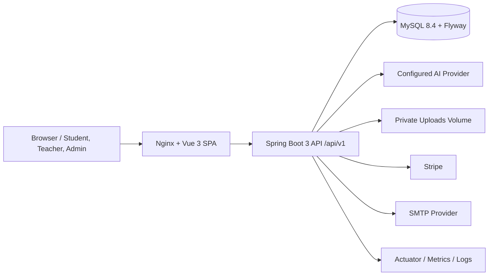

# AI-Powered Interactive Chinese Learning Platform

MandarinSpark 是一个面向年轻学习者的 AI 辅助中文学习平台，覆盖学生学习、教师内容与班级管理、管理员审核与运营配置，以及可配置的 AI、支付、邮件和发布安全流程。项目目标是把中文入门学习中的词汇、听力、书写、故事阅读、课堂互动和即时反馈整合到一个可演示、可测试、可部署的全栈系统中。

## 核心能力

| 用户角色 | 已覆盖能力                                                                                                                         |
| -------- | ---------------------------------------------------------------------------------------------------------------------------------- |
| 学生     | 首页学习总览、课程学习、练习活动、测验、直播课/录播课、成就奖励、AI 学习助手、个人资料、订单与退款入口                             |
| 教师     | 内容创建与维护、班级安排、学生进度查看、学习反馈、教师资料、收益与审核状态                                                         |
| 管理员   | 用户管理、教师认证审核、内容审核、活动库维护、AI 回复举报处理、财务与平台设置、运营分析                                            |
| 平台     | JWT + HttpOnly refresh cookie 会话、RBAC、IDOR 防护、AI 限流与可用性门控、Stripe 支付、SMTP 邮件、文件上传校验、健康检查与发布门禁 |

## 架构



### 运行时边界

- **前端**：Vue 3 SPA 负责路由、角色守卫、预览模式、API 调用、PWA shell 和学生/教师/管理员 UI。
- **后端**：Spring Boot API 负责鉴权、业务规则、事务边界、文件校验、AI/支付/邮件供应商适配和审计日志。
- **数据库**：MySQL 8.4 通过 Flyway 管理结构；JPA 使用 `validate`，避免运行时自动改表。
- **外部供应商**：AI、Stripe、SMTP 均可通过环境变量切换或关闭；生产 profile 对关键配置 fail-fast。
- **部署入口**：生产 Compose 使用 Nginx 代理前端和后端 API，后端只信任固定内部代理 IP 提供的转发头。

## 技术栈

| 层         | 技术                                                                                           |
| ---------- | ---------------------------------------------------------------------------------------------- |
| Frontend   | Vue 3, TypeScript, Pinia, Vue Router, Vue I18n, Vite, PWA, Sentry, Lucide icons                |
| Backend    | Java 21, Spring Boot 3.5, Spring Security, Spring Data JPA, Bean Validation, SpringDoc OpenAPI |
| Data       | MySQL 8.4, Flyway, Hibernate validate mode                                                     |
| AI         | DeepSeek/OpenAI-compatible HTTP provider, configurable no-real-provider guard, per-user quota  |
| Commerce   | Stripe checkout/webhook pipeline, mock/no-op providers for non-production                      |
| Operations | Docker Compose, Nginx, Actuator, Micrometer/Prometheus, SpotBugs, JaCoCo, Playwright           |

## 目录结构

```text
.
├── backend/                  Spring Boot API, domain services, JPA entities, tests, Flyway baseline
├── frontend/                 Vue 3 SPA, role pages, API wrapper, stores, browser QA and Playwright tests
├── docs/                     API policy, operations runbook, release precheck runbook
├── scripts/                  Root-level release/quality helper scripts
├── performance/              k6 smoke-capacity script
├── docker-compose.prod.yml   Full-stack production-style Compose deployment
├── .env.prod.example         Production environment template
└── package.json              Root quality-gate commands
```

## 已设置的生产安全基线

- **AI 事务边界**：AI 文本生成的外部 HTTP 调用不再包在长数据库事务内；推荐上下文仅在短只读事务中加载；AI 音频/图像文件复制也在事务外执行，仅元数据落库使用短事务。
- **AI 限流与可用性**：真实供应商调用有用户级速率限制，默认每分钟 10 次、每天 100 次；供应商不可用时返回明确不可用状态，不生成假内容。
- **认证与会话**：访问令牌短有效期，refresh token 使用 HttpOnly cookie；登录、注册和忘记密码入口均有有界限流。
- **邮件投递**：密码重置与教师审核邮件只在事务成功提交后由有界异步执行器投递，SMTP 延迟不会占用业务事务。当前队列为进程内 best-effort，要求跨重启可靠投递时需升级为持久化 outbox/队列。
- **缓存与性能**：常用平台设置、商务设置和公开目录查询使用 Caffeine 五分钟缓存；前端构建拆分 framework、networking、icons 等 chunk。
- **安全响应头**：后端与前端静态服务均发送 CSP 等安全响应头，CORS 方法与请求头使用显式允许列表。
- **可观测性**：AI provider latency 指标已通过 Micrometer 记录；Prometheus 端点默认不对公网暴露。
- **配置门禁**：Hikari 池、优雅关闭超时、AI 限额、登录限流和匿名认证限流均可通过环境变量配置。

## 本地运行

依赖：

- Java 21
- Node.js 22
- Docker Desktop，或可访问的 MySQL 8.4

启动数据库和后端：

```powershell
cd backend
docker compose up -d
$env:DB_USERNAME = "aichinese_app"
$env:DB_PASSWORD = "replace-with-a-strong-application-db-password"
$env:JWT_SECRET = "local-development-secret-with-at-least-32-characters"
.\mvnw.cmd spring-boot:run
```

本地 `backend/docker-compose.yml` 会把 MySQL 8.4 暴露在 `localhost:3307`，并使用与 `application.yml` 默认值一致的数据库名与用户名。若通过 IDE 启动后端，请把同等环境变量设置到 IDE 运行配置。真实 AI、Stripe 和 SMTP 在本地默认应保持关闭，或使用测试凭据。

启动前端：

```powershell
cd frontend
npm ci
npm run dev
```

常用本地地址：

- 前端：`http://localhost:5173`
- 后端 API：`http://localhost:8080/api/v1`
- OpenAPI JSON：`http://localhost:8080/v3/api-docs`
- Swagger UI：`http://localhost:8080/swagger-ui.html`
- 健康检查：`http://localhost:8080/actuator/health`

## 测试与质量门禁

推荐从仓库根目录运行完整质量门禁：

```powershell
npm run quality
```

该命令会执行前端 lint、格式检查、单元测试、类型检查、生产构建，以及后端测试、SpotBugs、覆盖率门禁和 OpenAPI 导出。

按需单独运行：

```powershell
npm --prefix frontend run test:e2e
npm run quality:backend
npm run quality:frontend
```

变更影响浏览器路由、登录态、角色守卫、核心 UI 流程或预览模式时，应额外运行：

```powershell
npm run quality:frontend:e2e
```

## 容器部署

根目录的 `docker-compose.prod.yml` 构建后端 Java 运行镜像及 Nginx 前端镜像，并启动 MySQL。创建部署配置并填写强密码、HTTPS URL 与供应商密钥：

```powershell
Copy-Item .env.prod.example .env.prod
docker compose --env-file .env.prod -f docker-compose.prod.yml up --build -d
```

生产配置会 fail-fast：示例文件中的密码/密钥空值必须填入；`JWT_SECRET` 不得为占位文本；`AI_ENABLE_REAL_PROVIDER=true` 且有效 AI 密钥必须配置；`SMTP_ENABLED=true` 且可用的 SMTP/密码重置 HTTPS 地址必须配置。否则容器或应用拒绝启动，避免弱签名令牌、不可用 AI 静默上线或密码重置邮件静默丢失。

Compose 还将 Nginx 前端代理固定在内部网络地址，并把该地址配置为后端唯一可信的转发代理；Nginx 会覆盖而非追加客户端提供的 `X-Forwarded-For`，使登录和匿名认证限流按不可伪造的原始客户端 IP 生效。覆盖 `FRONTEND_PROXY_IP` 时，必须保持它属于 `APP_NETWORK_SUBNET`，并同步覆盖 `APP_SECURITY_FORWARDED_TRUSTED_PROXIES`。

本配置使用持久化卷保存上传文件，适用于单实例部署。水平扩展前，必须将上传存储替换为 S3 兼容对象存储，并将 AI 限流、refresh-token 会话一致性策略和异步邮件投递升级为共享/持久化机制。

## 关键环境变量

| 分类     | 变量                                                                                                       |
| -------- | ---------------------------------------------------------------------------------------------------------- |
| 数据库   | `DB_ROOT_PASSWORD`, `DB_NAME`, `DB_USERNAME`, `DB_PASSWORD`, `DB_MAX_POOL_SIZE`                            |
| 安全     | `JWT_SECRET`, `JWT_EXPIRATION`, `JWT_REFRESH_EXPIRATION`, `APP_CORS_ALLOWED_ORIGINS`                       |
| 转发代理 | `APP_NETWORK_SUBNET`, `FRONTEND_PROXY_IP`, `APP_SECURITY_FORWARDED_TRUSTED_PROXIES`                        |
| AI       | `AI_ENABLE_REAL_PROVIDER`, `AI_PROVIDER`, `AI_API_BASE_URL`, `AI_API_KEY`, `AI_MODEL_NAME`                 |
| 支付     | `PAYMENT_PROVIDER`, `STRIPE_API_KEY`, `STRIPE_WEBHOOK_SECRET`, `PAYMENT_SUCCESS_URL`, `PAYMENT_CANCEL_URL` |
| 邮件     | `SMTP_ENABLED`, `SMTP_HOST`, `SMTP_USERNAME`, `SMTP_PASSWORD`, `PASSWORD_RESET_BASE_URL`                   |
| 前端     | `VITE_API_BASE_URL`, `VITE_SENTRY_DSN`, `APP_RELEASE`, `VITE_GIT_SHA`                                      |

完整发布前检查请使用 `docs/RELEASE_PRECHECK_RUNBOOK.md`。

## 运维

- **健康检查**：`/actuator/health`、`/actuator/health/liveness`、`/actuator/health/readiness`。
- **Prometheus**：仅在内部或受认证采集路径上设置 `MANAGEMENT_EXPOSED_ENDPOINTS=health,info,prometheus`。
- **关键观察项**：`aichinese.ai.provider.duration`、HTTP 4xx/5xx、Hikari 活跃连接数、AI 429、支付失败率、Stripe webhook 重放/签名失败、SMTP 失败日志。
- **备份恢复**：生产部署应由托管数据库备份或经过演练的备份/恢复流程保护数据。
- **发布证据**：每次发布应记录质量门禁输出、Compose config 校验、数据库迁移校验、浏览器 smoke、备份恢复演练和 DAST/依赖扫描结果。

## 数据库迁移约定

`V1__consolidated_schema.sql` 是当前唯一的合并基线迁移，包含表、索引、约束、种子数据、refresh token 会话、AI 使用日志和全文搜索索引。项目在正式生产冻结前，已接受的结构修改都折叠回这个单一 V1；冻结并部署到长期生产数据库后，才通过明确的 baseline/squash 流程建立新的迁移策略。

生产冻结后，任何已应用迁移都不可重命名、修改或删除；所有结构变化必须使用新的 forward-only migration，并同时测试 clean install 与从最新生产版本升级。

## 已知扩展边界

- **单实例上传存储**：当前生产 Compose 使用持久化卷；多实例部署前应切换到对象存储或共享文件服务。
- **进程内限流**：AI 与认证限流适合单实例；多实例需要 Redis 或数据库级共享限流。
- **异步邮件**：当前 post-commit dispatcher 是进程内 best-effort；高可靠邮件需要 outbox/queue。
- **真实生产验证**：仓库可完成本地和 CI 质量门禁，但上线前仍需使用真实域名、HTTPS、生产供应商密钥和备份策略做最终 rehearsal。

## 文档

- [架构说明](docs/ARCHITECTURE.md)
- [测试策略](docs/TESTING_STRATEGY.md)
- [发布前预检 Runbook](docs/RELEASE_PRECHECK_RUNBOOK.md)
- [运维 Runbook](docs/OPERATIONS_RUNBOOK.md)
- [API 版本策略](docs/API_VERSIONING_POLICY.md)
- [贡献与迁移规则](CONTRIBUTING.md)
- [安全政策](SECURITY.md)
- [变更记录](CHANGELOG.md)
