# AI-Powered Interactive Chinese Learning Platform for Young Learners

This diagram pack is grounded in the current repository structure, documented workflows, backend entities, frontend routes, deployment notes, and phase history. It reflects the implemented roles, APIs, states, and modules in the project rather than a generic school-project template.

## 1. Conceptual Framework Diagram

```mermaid
flowchart LR
    subgraph Inputs["Independent Variables / Inputs"]
        I1["Structured Chinese learning content<br/>modules, lessons, activities, quizzes"]
        I2["Teacher-created educational resources<br/>flashcards, quizzes, live classes, recorded videos"]
        I3["AI-assisted learning support<br/>chat tutor, vocabulary helper, sentence practice, story and quiz generation"]
        I4["Student interaction data<br/>attempts, progress, weak areas, rewards, notifications"]
        I5["Platform governance controls<br/>teacher verification, moderation, support, audit logs"]
    end

    subgraph CoreSystem["Mediating Platform Processes"]
        P1["Role-based access control<br/>Guest, Student, Teacher, Admin"]
        P2["Learning delivery engine<br/>lesson player, interactive activities, hybrid learning"]
        P3["AI assistance layer<br/>provider routing, fallback handling, usage logging"]
        P4["Commerce and entitlement layer<br/>cart, checkout, payment, subscription, unlock rules"]
        P5["Trust and governance layer<br/>verification, moderation, notifications, support"]
        P6["Analytics and feedback layer<br/>student, teacher, admin dashboards"]
    end

    subgraph Outputs["Immediate System Outputs"]
        O1["Improved lesson accessibility"]
        O2["Personalized practice guidance"]
        O3["Teacher content submission and management"]
        O4["Secure admin oversight and approvals"]
        O5["Progress, points, badges, and streak updates"]
    end

    subgraph Outcomes["Expected Educational Outcomes"]
        R1["Higher student engagement"]
        R2["Better Chinese practice continuity"]
        R3["More efficient teacher content production"]
        R4["Safer and better-governed platform operations"]
        R5["Data-informed learning and management decisions"]
    end

    I1 --> CoreSystem
    I2 --> CoreSystem
    I3 --> CoreSystem
    I4 --> CoreSystem
    I5 --> CoreSystem

    CoreSystem --> Outputs
    Outputs --> Outcomes

    P6 -. feedback loop .-> P2
    P6 -. feedback loop .-> P3
    P5 -. control constraints .-> P2
    P5 -. control constraints .-> P4
```

## 2. Development Methodology Flow Diagram

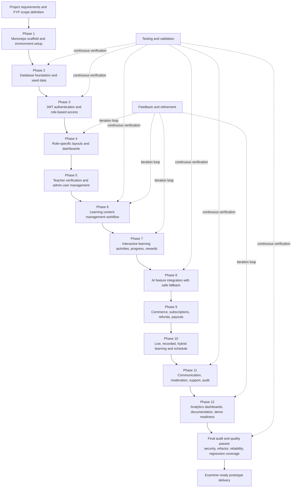

## 3. System Architecture Diagram

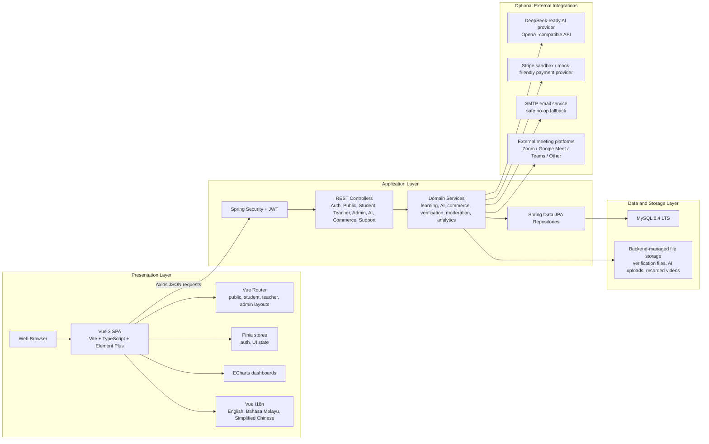

## 4. System Context Diagram

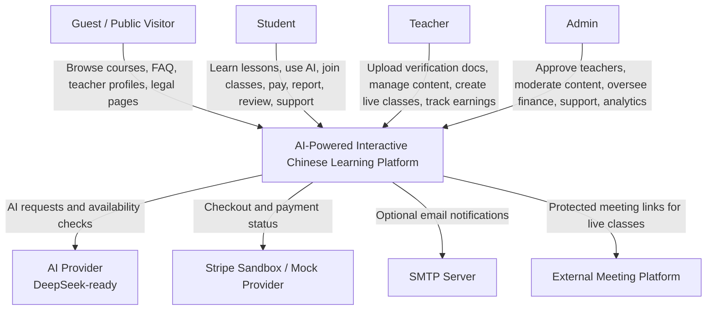

## 5. Overall Use Case Diagram

```mermaid
flowchart LR
    Guest["Guest"]
    Student["Student"]
    Teacher["Teacher"]
    Admin["Admin"]

    subgraph UseCases["Platform Use Cases"]
        UC1(("Browse published courses"))
        UC2(("Register and log in"))
        UC3(("View lesson player and activities"))
        UC4(("Attempt quiz and review wrong answers"))
        UC5(("Use AI tutor and AI learning tools"))
        UC6(("Track progress, rewards, streaks"))
        UC7(("Join live class / watch recorded lesson"))
        UC8(("Add to cart, buy now, view payments, request refund"))
        UC9(("Create reports, reviews, support tickets"))
        UC10(("Upload teacher verification documents"))
        UC11(("Create modules, lessons, packages"))
        UC12(("Manage flashcards, quizzes, matching, listening, tracing"))
        UC13(("Create live classes and recorded videos"))
        UC14(("Use teacher AI assistant"))
        UC15(("View earnings and request payout"))
        UC16(("Approve or reject teachers"))
        UC17(("Review, approve, publish, archive content"))
        UC18(("Handle moderation, reviews, reports, support"))
        UC19(("Monitor AI usage, payments, refunds, payouts"))
        UC20(("View analytics dashboards"))
    end

    Guest --> UC1
    Guest --> UC2

    Student --> UC2
    Student --> UC3
    Student --> UC4
    Student --> UC5
    Student --> UC6
    Student --> UC7
    Student --> UC8
    Student --> UC9

    Teacher --> UC2
    Teacher --> UC10
    Teacher --> UC11
    Teacher --> UC12
    Teacher --> UC13
    Teacher --> UC14
    Teacher --> UC15
    Teacher --> UC20

    Admin --> UC16
    Admin --> UC17
    Admin --> UC18
    Admin --> UC19
    Admin --> UC20
```

## 6. Entity Relationship Diagram

```mermaid
erDiagram
    USER {
        bigint id PK
        string email
        string password_hash
        string display_name
        string preferred_language
        boolean active
    }

    ROLE {
        bigint id PK
        string name
    }

    USER_ROLE {
        bigint user_id FK
        bigint role_id FK
    }

    STUDENT_PROFILE {
        bigint id PK
        bigint user_id FK
        bigint current_level_id FK
        string display_name
        int total_points
    }

    TEACHER_PROFILE {
        bigint id PK
        bigint user_id FK
        string teacher_status
        string bio
        string teaching_categories
        string rejection_reason
        boolean public_visible
        datetime verified_at
    }

    LEARNING_LEVEL {
        bigint id PK
        string name
    }

    LEARNING_CATEGORY {
        bigint id PK
        string name
    }

    LEARNING_MODULE {
        bigint id PK
        bigint teacher_id FK
        bigint level_id FK
        bigint category_id FK
        string title
        string content_status
        string access_type
    }

    LESSON {
        bigint id PK
        bigint module_id FK
        bigint teacher_id FK
        bigint level_id FK
        bigint category_id FK
        string title
        string content_status
        string access_type
        string learning_type
        decimal price
    }

    LESSON_ACTIVITY {
        bigint id PK
        bigint lesson_id FK
        string activity_type
        string title
        string content_status
    }

    FLASHCARD {
        bigint id PK
        bigint lesson_id FK
        string front_text
        string back_text
        string content_status
    }

    QUIZ {
        bigint id PK
        bigint lesson_id FK
        bigint teacher_id FK
        string title
        string content_status
    }

    QUIZ_QUESTION {
        bigint id PK
        bigint quiz_id FK
        string question_text
        string question_type
        string correct_answer_text
        int points
    }

    QUIZ_OPTION {
        bigint id PK
        bigint question_id FK
        string option_text
        boolean correct_option
    }

    QUIZ_ATTEMPT {
        bigint id PK
        bigint quiz_id FK
        bigint student_id FK
        int score
        int max_score
        boolean submitted
        datetime started_at
        datetime completed_at
    }

    QUIZ_ATTEMPT_ANSWER {
        bigint id PK
        bigint quiz_attempt_id FK
        bigint question_id FK
        string answer_text
        boolean correct
    }

    MATCHING_GAME {
        bigint id PK
        bigint lesson_id FK
        string title
        string content_status
    }

    MATCHING_GAME_ITEM {
        bigint id PK
        bigint matching_game_id FK
        string left_text
        string right_text
    }

    LISTENING_EXERCISE {
        bigint id PK
        bigint lesson_id FK
        string title
        string content_status
    }

    TRACING_EXERCISE {
        bigint id PK
        bigint lesson_id FK
        string title
        string target_character
        string content_status
    }

    COURSE_PACKAGE {
        bigint id PK
        bigint teacher_id FK
        bigint level_id FK
        bigint category_id FK
        string title
        string content_status
        string access_type
        string learning_type
        decimal price
    }

    PACKAGE_ITEM {
        bigint id PK
        bigint course_package_id FK
        string item_type
        bigint item_id
        int sort_order
    }

    LIVE_CLASS {
        bigint id PK
        bigint teacher_id FK
        bigint lesson_id FK
        bigint course_package_id FK
        string title
        string meeting_platform
        string live_class_status
        datetime scheduled_start_at
        datetime scheduled_end_at
    }

    LIVE_CLASS_ENROLMENT {
        bigint id PK
        bigint live_class_id FK
        bigint student_id FK
        string enrolment_status
    }

    UPLOADED_FILE {
        bigint id PK
        bigint uploaded_by_user_id FK
        string stored_file_name
        string original_file_name
        string content_type
        string storage_path
    }

    RECORDED_LESSON_VIDEO {
        bigint id PK
        bigint lesson_id FK
        bigint course_package_id FK
        bigint uploaded_file_id FK
        string source_type
        string title
        string external_video_url
        boolean active
    }

    VIDEO_PROGRESS {
        bigint id PK
        bigint student_id FK
        bigint recorded_lesson_video_id FK
        bigint lesson_id FK
        int progress_percent
        boolean completed
    }

    STUDENT_ACTIVITY_PROGRESS {
        bigint id PK
        bigint student_id FK
        bigint lesson_id FK
        string activity_type
        bigint activity_source_id
        boolean completed
    }

    LESSON_PROGRESS {
        bigint id PK
        bigint student_id FK
        bigint lesson_id FK
        int completion_percent
        boolean completed
    }

    STUDENT_PROGRESS {
        bigint id PK
        bigint student_id FK
        bigint level_id FK
        int completion_percent
        string weak_areas
    }

    POINTS_TRANSACTION {
        bigint id PK
        bigint student_id FK
        int points_delta
        string source_type
        bigint source_id
        string reason
    }

    BADGE {
        bigint id PK
        string name
        string description
        string icon_key
    }

    STUDENT_BADGE {
        bigint id PK
        bigint student_id FK
        bigint badge_id FK
        datetime awarded_at
    }

    DAILY_STREAK {
        bigint id PK
        bigint student_id FK
        int current_streak
        int best_streak
        date last_learning_date
    }

    CART {
        bigint id PK
        bigint student_id FK
    }

    CART_ITEM {
        bigint id PK
        bigint cart_id FK
        string item_type
        bigint item_id
    }

    ORDER {
        bigint id PK
        bigint student_id FK
        string order_number
        decimal total_amount
        string currency_code
        string payment_status
    }

    ORDER_ITEM {
        bigint id PK
        bigint order_id FK
        bigint teacher_id FK
        string item_type
        bigint item_id
        decimal unit_price
    }

    PAYMENT_RECORD {
        bigint id PK
        bigint order_id FK
        bigint student_id FK
        string provider_name
        string provider_reference
        decimal amount
        string payment_status
        datetime paid_at
    }

    PAYMENT_ENTITLEMENT {
        bigint id PK
        bigint student_id FK
        bigint order_id FK
        bigint payment_record_id FK
        string item_type
        bigint item_id
        string feature_key
        boolean active
    }

    SUBSCRIPTION_PLAN {
        bigint id PK
        string name
        decimal price
        boolean active
    }

    STUDENT_SUBSCRIPTION {
        bigint id PK
        bigint student_id FK
        bigint plan_id FK
        bigint payment_record_id FK
        string subscription_status
        datetime starts_at
        datetime ends_at
    }

    REFUND_REQUEST {
        bigint id PK
        bigint student_id FK
        bigint payment_record_id FK
        string refund_status
        string reason
    }

    TEACHER_EARNING {
        bigint id PK
        bigint teacher_id FK
        bigint order_item_id FK
        string earning_status
        decimal gross_amount
        decimal commission_amount
        decimal net_amount
    }

    PAYOUT_REQUEST {
        bigint id PK
        bigint teacher_id FK
        decimal amount
        string payout_status
    }

    TEACHER_VERIFICATION_DOCUMENT {
        bigint id PK
        bigint teacher_id FK
        bigint uploaded_file_id FK
        string document_type
        datetime submitted_at
    }

    TEACHER_VERIFICATION_REVIEW {
        bigint id PK
        bigint teacher_id FK
        bigint document_id FK
        bigint reviewer_user_id FK
        string decision_status
        string review_note
        datetime reviewed_at
    }

    NOTIFICATION {
        bigint id PK
        bigint user_id FK
        bigint related_user_id FK
        string notification_type
        string status
    }

    REPORT {
        bigint id PK
        bigint reporter_id FK
        bigint related_teacher_id FK
        string target_type
        bigint target_id
        string report_status
    }

    REVIEW {
        bigint id PK
        bigint student_id FK
        string target_type
        bigint target_id
        string review_status
        int rating
    }

    TEACHER_FEEDBACK {
        bigint id PK
        bigint teacher_id FK
        bigint student_id FK
        bigint lesson_id FK
        bigint quiz_attempt_id FK
    }

    SUPPORT_TICKET {
        bigint id PK
        bigint created_by_user_id FK
        string subject
        string ticket_status
        string ticket_priority
    }

    SUPPORT_TICKET_MESSAGE {
        bigint id PK
        bigint support_ticket_id FK
        bigint sender_user_id FK
    }

    CONTENT_MODERATION_RECORD {
        bigint id PK
        bigint admin_user_id FK
        bigint related_teacher_id FK
        string target_type
        bigint target_id
        string action_type
    }

    AUDIT_LOG {
        bigint id PK
        bigint actor_user_id FK
        string action_type
        string target_type
        bigint target_id
    }

    AI_CHAT_SESSION {
        bigint id PK
        bigint user_id FK
        string title
    }

    AI_CHAT_MESSAGE {
        bigint id PK
        bigint session_id FK
        string message_role
    }

    AI_GENERATION_RECORD {
        bigint id PK
        bigint user_id FK
        string feature_key
        string request_status
    }

    AI_FEEDBACK_RECORD {
        bigint id PK
        bigint user_id FK
        bigint uploaded_file_id FK
        string feature_key
        string request_status
    }

    AI_USAGE_LOG {
        bigint id PK
        bigint user_id FK
        string feature_key
        string provider_name
        string model_name
        string status
    }

    SYSTEM_SETTING {
        bigint id PK
        string setting_key
        string setting_value
    }

    USER ||--o{ USER_ROLE : has
    ROLE ||--o{ USER_ROLE : grants
    USER ||--|| STUDENT_PROFILE : owns
    USER ||--|| TEACHER_PROFILE : owns
    LEARNING_LEVEL ||--o{ STUDENT_PROFILE : current_level
    LEARNING_LEVEL ||--o{ LEARNING_MODULE : classifies
    LEARNING_LEVEL ||--o{ LESSON : classifies
    LEARNING_LEVEL ||--o{ COURSE_PACKAGE : classifies
    LEARNING_LEVEL ||--o{ STUDENT_PROGRESS : classifies
    LEARNING_CATEGORY ||--o{ LEARNING_MODULE : classifies
    LEARNING_CATEGORY ||--o{ LESSON : classifies
    LEARNING_CATEGORY ||--o{ COURSE_PACKAGE : classifies

    TEACHER_PROFILE ||--o{ LEARNING_MODULE : creates
    TEACHER_PROFILE ||--o{ LESSON : creates
    TEACHER_PROFILE ||--o{ COURSE_PACKAGE : creates
    LEARNING_MODULE ||--o{ LESSON : contains
    LESSON ||--o{ LESSON_ACTIVITY : contains
    LESSON ||--o{ FLASHCARD : contains
    LESSON ||--o{ QUIZ : contains
    QUIZ ||--o{ QUIZ_QUESTION : contains
    QUIZ_QUESTION ||--o{ QUIZ_OPTION : offers
    STUDENT_PROFILE ||--o{ QUIZ_ATTEMPT : makes
    QUIZ ||--o{ QUIZ_ATTEMPT : receives
    QUIZ_ATTEMPT ||--o{ QUIZ_ATTEMPT_ANSWER : stores
    QUIZ_QUESTION ||--o{ QUIZ_ATTEMPT_ANSWER : answers
    LESSON ||--o{ MATCHING_GAME : contains
    MATCHING_GAME ||--o{ MATCHING_GAME_ITEM : contains
    LESSON ||--o{ LISTENING_EXERCISE : contains
    LESSON ||--o{ TRACING_EXERCISE : contains
    COURSE_PACKAGE ||--o{ PACKAGE_ITEM : contains

    TEACHER_PROFILE ||--o{ LIVE_CLASS : hosts
    LESSON ||--o{ LIVE_CLASS : links
    COURSE_PACKAGE ||--o{ LIVE_CLASS : links
    STUDENT_PROFILE ||--o{ LIVE_CLASS_ENROLMENT : owns
    LIVE_CLASS ||--o{ LIVE_CLASS_ENROLMENT : has
    LESSON ||--o{ RECORDED_LESSON_VIDEO : has
    COURSE_PACKAGE ||--o{ RECORDED_LESSON_VIDEO : links
    UPLOADED_FILE ||--o{ RECORDED_LESSON_VIDEO : stores
    STUDENT_PROFILE ||--o{ VIDEO_PROGRESS : tracks
    RECORDED_LESSON_VIDEO ||--o{ VIDEO_PROGRESS : has

    STUDENT_PROFILE ||--o{ STUDENT_ACTIVITY_PROGRESS : produces
    LESSON ||--o{ STUDENT_ACTIVITY_PROGRESS : groups
    STUDENT_PROFILE ||--o{ LESSON_PROGRESS : produces
    LESSON ||--o{ LESSON_PROGRESS : tracks
    STUDENT_PROFILE ||--o{ STUDENT_PROGRESS : summarizes
    STUDENT_PROFILE ||--o{ POINTS_TRANSACTION : earns
    STUDENT_PROFILE ||--o{ STUDENT_BADGE : receives
    BADGE ||--o{ STUDENT_BADGE : awards
    STUDENT_PROFILE ||--o{ DAILY_STREAK : maintains

    STUDENT_PROFILE ||--o| CART : owns
    CART ||--o{ CART_ITEM : contains
    STUDENT_PROFILE ||--o{ ORDER : places
    ORDER ||--o{ ORDER_ITEM : contains
    TEACHER_PROFILE ||--o{ ORDER_ITEM : owns
    ORDER ||--o{ PAYMENT_RECORD : creates
    STUDENT_PROFILE ||--o{ PAYMENT_RECORD : pays
    STUDENT_PROFILE ||--o{ PAYMENT_ENTITLEMENT : receives
    ORDER ||--o{ PAYMENT_ENTITLEMENT : grants
    PAYMENT_RECORD ||--o{ PAYMENT_ENTITLEMENT : supports
    STUDENT_PROFILE ||--o{ STUDENT_SUBSCRIPTION : holds
    SUBSCRIPTION_PLAN ||--o{ STUDENT_SUBSCRIPTION : defines
    PAYMENT_RECORD ||--o{ STUDENT_SUBSCRIPTION : funds
    STUDENT_PROFILE ||--o{ REFUND_REQUEST : files
    PAYMENT_RECORD ||--o{ REFUND_REQUEST : targets
    TEACHER_PROFILE ||--o{ TEACHER_EARNING : receives
    ORDER_ITEM ||--o{ TEACHER_EARNING : generates
    TEACHER_PROFILE ||--o{ PAYOUT_REQUEST : requests

    TEACHER_PROFILE ||--o{ TEACHER_VERIFICATION_DOCUMENT : submits
    UPLOADED_FILE ||--o{ TEACHER_VERIFICATION_DOCUMENT : stores
    TEACHER_PROFILE ||--o{ TEACHER_VERIFICATION_REVIEW : receives
    TEACHER_VERIFICATION_DOCUMENT ||--o{ TEACHER_VERIFICATION_REVIEW : reviews
    USER ||--o{ TEACHER_VERIFICATION_REVIEW : performs

    USER ||--o{ NOTIFICATION : receives
    USER ||--o{ REPORT : files
    TEACHER_PROFILE ||--o{ REPORT : concerns
    STUDENT_PROFILE ||--o{ REVIEW : writes
    TEACHER_PROFILE ||--o{ TEACHER_FEEDBACK : writes
    STUDENT_PROFILE ||--o{ TEACHER_FEEDBACK : receives
    LESSON ||--o{ TEACHER_FEEDBACK : references
    QUIZ_ATTEMPT ||--o{ TEACHER_FEEDBACK : references
    USER ||--o{ SUPPORT_TICKET : creates
    SUPPORT_TICKET ||--o{ SUPPORT_TICKET_MESSAGE : contains
    USER ||--o{ SUPPORT_TICKET_MESSAGE : sends
    USER ||--o{ CONTENT_MODERATION_RECORD : acts
    TEACHER_PROFILE ||--o{ CONTENT_MODERATION_RECORD : concerns
    USER ||--o{ AUDIT_LOG : acts

    USER ||--o{ AI_CHAT_SESSION : owns
    AI_CHAT_SESSION ||--o{ AI_CHAT_MESSAGE : contains
    USER ||--o{ AI_GENERATION_RECORD : triggers
    USER ||--o{ AI_FEEDBACK_RECORD : triggers
    UPLOADED_FILE ||--o{ AI_FEEDBACK_RECORD : references
    USER ||--o{ AI_USAGE_LOG : generates
```

## 7. Component Diagram

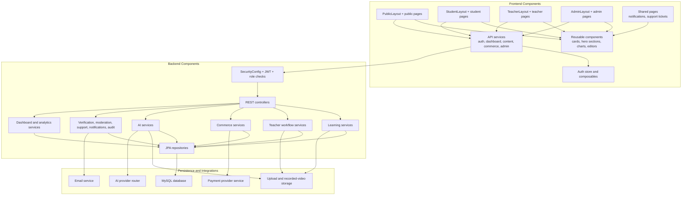

## 8. Deployment Diagram

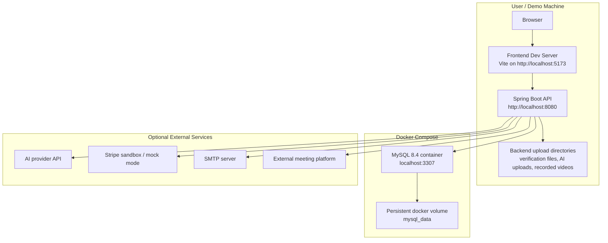

## 9. Activity Diagram - Student Learning Flow

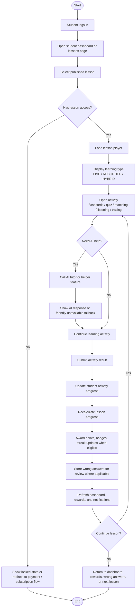

## 10. Activity Diagram - Teacher Content Creation Flow

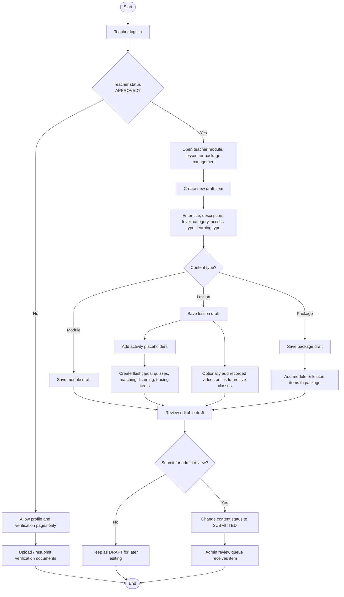

## 11. Activity Diagram - Administrator Teacher Verification Flow

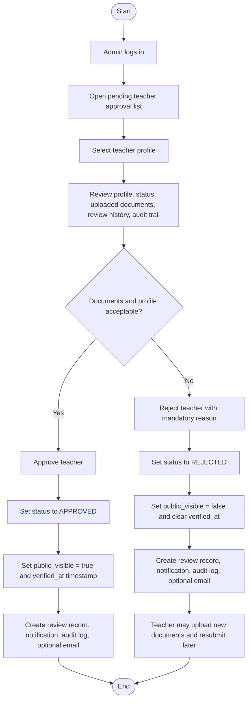

## 12. Sequence Diagram - User Login

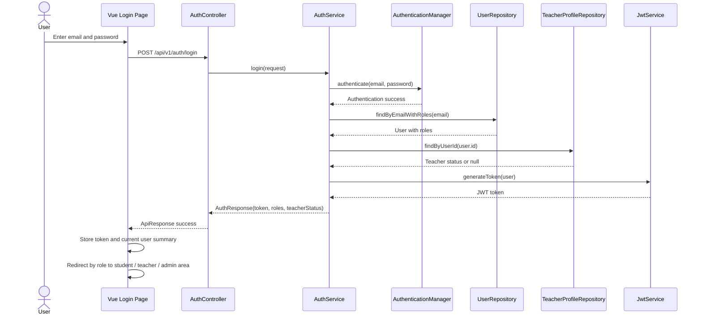

## 13. Sequence Diagram - AI Chat Tutor Request

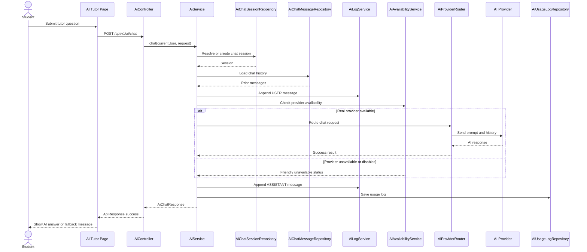

## 14. Sequence Diagram - Quiz Attempt

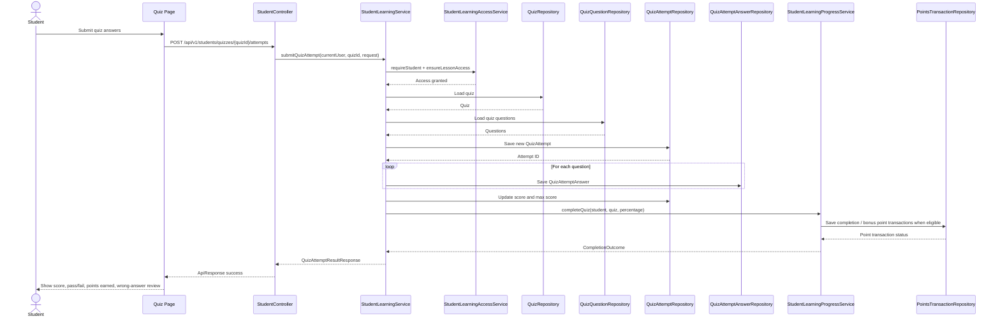

## 15. Sequence Diagram - Teacher Content Creation

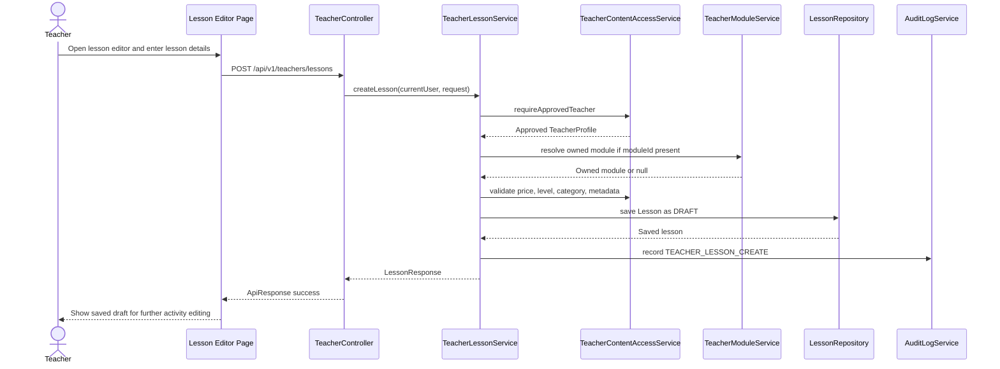

## 16. Sequence Diagram - Admin Teacher Verification

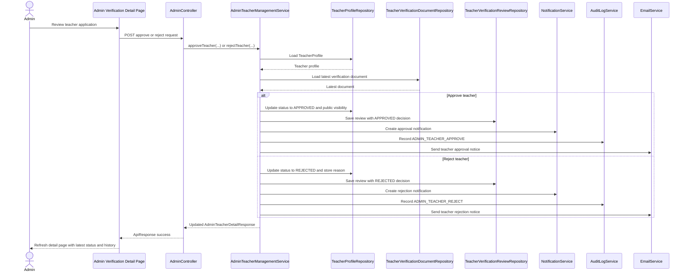

## 17. State Machine Diagram - Teacher Verification Status

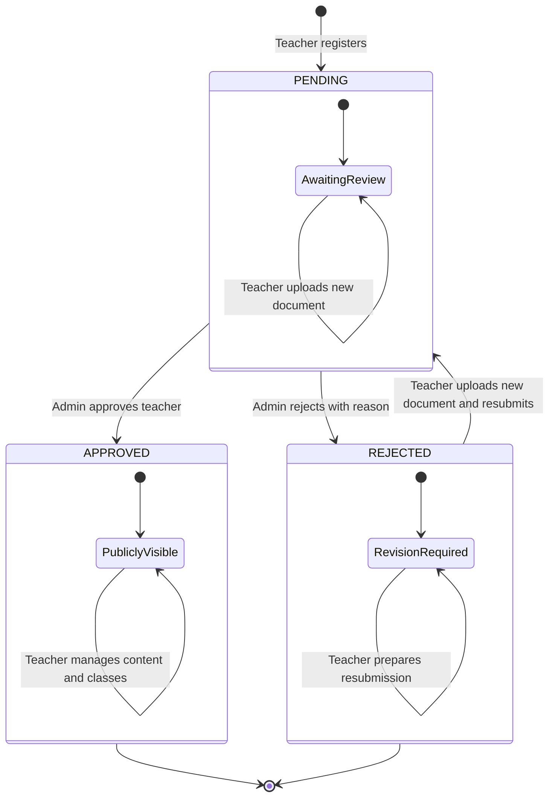

## 18. Site Map / Navigation Flow Diagram

```mermaid
flowchart TB
    Root["/"]

    subgraph PublicArea["Public Area"]
        Landing["/"]
        Login["/login"]
        Register["/register"]
        Courses["/courses"]
        CourseDetail["/courses/:id"]
        TeacherProfile["/teachers/:id"]
        FAQ["/faq"]
        Terms["/terms"]
        Privacy["/privacy"]
        ChildSafety["/child-safety"]
        AiDisclaimer["/ai-disclaimer"]
        NotFound["* -> 404"]
    end

    subgraph StudentArea["Student Area"]
        SDash["/student/dashboard"]
        SLessons["/student/lessons"]
        SLesson["/student/lessons/:lessonId"]
        SQuiz["/student/quizzes/:quizId"]
        SWrong["/student/wrong-answers"]
        SAI["/student/ai/*"]
        SLive["/student/live-classes"]
        SSchedule["/student/schedule"]
        SRecorded["/student/recorded-lessons/:id"]
        SCart["/student/cart"]
        SPay["/student/payments"]
        SSub["/student/subscription"]
        SRewards["/student/rewards"]
        SProgress["/student/progress"]
        SReports["/student/reports"]
        SReviews["/student/reviews"]
        SFeedback["/student/feedback"]
        SNotify["/student/notifications"]
        SSupport["/student/support-tickets"]
    end

    subgraph TeacherArea["Teacher Area"]
        TDash["/teacher/dashboard"]
        TProfile["/teacher/profile"]
        TVerify["/teacher/verification-status"]
        TModules["/teacher/modules"]
        TLessons["/teacher/lessons"]
        TLessonEdit["/teacher/lessons/new or :id/edit"]
        TPackages["/teacher/packages"]
        TLive["/teacher/live-classes"]
        TRecorded["/teacher/recorded-lessons"]
        TSchedule["/teacher/schedule"]
        TActivities["/teacher/quizzes, flashcards, matching, listening, tracing"]
        TAI["/teacher/ai/*"]
        TEarnings["/teacher/earnings"]
        TPayouts["/teacher/payouts"]
        TReviews["/teacher/reviews"]
        TReports["/teacher/reports"]
        TModeration["/teacher/moderation-records"]
        TNotify["/teacher/notifications"]
        TSupport["/teacher/support-tickets"]
    end

    subgraph AdminArea["Admin Area"]
        ADash["/admin/dashboard"]
        AUsers["/admin/users"]
        AStudents["/admin/students"]
        ATeacherApproval["/admin/teacher-approval"]
        AContent["/admin/content/approvals"]
        AModeration["/admin/moderation and /admin/content/moderation"]
        AAI["/admin/ai-usage-logs"]
        APay["/admin/payments"]
        ARefunds["/admin/refunds"]
        APayouts["/admin/payouts"]
        ASubs["/admin/subscription-plans"]
        ALive["/admin/live-classes"]
        ASchedule["/admin/schedule"]
        AReports["/admin/reports"]
        AReviews["/admin/reviews"]
        ASupport["/admin/support-tickets"]
        AAudit["/admin/audit-logs"]
        ANotify["/admin/notifications"]
    end

    Root --> Landing
    Landing --> Login
    Landing --> Register
    Landing --> Courses
    Courses --> CourseDetail
    CourseDetail --> TeacherProfile
    Landing --> FAQ
    Landing --> Terms
    Landing --> Privacy
    Landing --> ChildSafety
    Landing --> AiDisclaimer
    Landing --> NotFound

    Login --> SDash
    Login --> TDash
    Login --> ADash

    SDash --> SLessons
    SLessons --> SLesson
    SLesson --> SQuiz
    SLesson --> SRecorded
    SDash --> SWrong
    SDash --> SAI
    SDash --> SLive
    SDash --> SSchedule
    SDash --> SCart
    SDash --> SPay
    SDash --> SSub
    SDash --> SRewards
    SDash --> SProgress
    SDash --> SReports
    SDash --> SReviews
    SDash --> SFeedback
    SDash --> SNotify
    SDash --> SSupport

    TDash --> TProfile
    TDash --> TVerify
    TDash --> TModules
    TDash --> TLessons
    TLessons --> TLessonEdit
    TDash --> TPackages
    TDash --> TLive
    TDash --> TRecorded
    TDash --> TSchedule
    TDash --> TActivities
    TDash --> TAI
    TDash --> TEarnings
    TDash --> TPayouts
    TDash --> TReviews
    TDash --> TReports
    TDash --> TModeration
    TDash --> TNotify
    TDash --> TSupport

    ADash --> AUsers
    ADash --> AStudents
    ADash --> ATeacherApproval
    ADash --> AContent
    ADash --> AModeration
    ADash --> AAI
    ADash --> APay
    ADash --> ARefunds
    ADash --> APayouts
    ADash --> ASubs
    ADash --> ALive
    ADash --> ASchedule
    ADash --> AReports
    ADash --> AReviews
    ADash --> ASupport
    ADash --> AAudit
    ADash --> ANotify
```

## 19. Selected UI Wireframes

### 19.1 Public Course Discovery Page Wireframe

```text
+----------------------------------------------------------------------------------+
| PUBLIC HEADER                                                                    |
| Logo | Home | Courses | FAQ | Terms | Privacy | Login | Register | Language      |
+----------------------------------------------------------------------------------+
| HERO SECTION                                                                     |
| "Explore Chinese Courses for Young Learners"                                     |
| Short description about structured, AI-assisted, safe learning                   |
+----------------------------------------------------------------------------------+
| FILTER BAR                                                                       |
| Search | Level | Category | Access Type | Learning Type | Sort | Apply Filters   |
+----------------------------------------------------------------------------------+
| COURSE GRID                                                                      |
| +----------------------+  +----------------------+  +----------------------+      |
| | Cover / Type Badge   |  | Cover / Type Badge   |  | Cover / Type Badge   |      |
| | Course Title         |  | Course Title         |  | Course Title         |      |
| | Short Description    |  | Short Description    |  | Short Description    |      |
| | Level / Category     |  | Level / Category     |  | Level / Category     |      |
| | Teacher Profile Link |  | Teacher Profile Link |  | Teacher Profile Link |      |
| | Price / Locked State |  | Price / Locked State |  | Price / Locked State |      |
| | View Detail | Cart   |  | View Detail | Cart   |  | View Detail | Cart   |      |
| +----------------------+  +----------------------+  +----------------------+      |
+----------------------------------------------------------------------------------+
| PAGINATION                                                                       |
+----------------------------------------------------------------------------------+
| FOOTER                                                                           |
+----------------------------------------------------------------------------------+
```

### 19.2 Student Dashboard Wireframe

```text
+----------------------------------------------------------------------------------+
| STUDENT SIDEBAR                                                                  |
| Dashboard | Lessons | AI Tools | Progress | Rewards | Cart | Payments | Support  |
+----------------------------------------------------------------------------------+
| HERO CARD                                                                        |
| Welcome, [Student Name]                                                          |
| Recommended next step                                                            |
| Continue Learning button                                                         |
+----------------------------------------------------------------------------------+
| STATS ROW                                                                        |
| Level | Progress % | Streak | Points | Badges                                   |
+----------------------------------------------------------------------------------+
| OVERVIEW ROW                                                                     |
| Completed Lessons | Average Quiz Score | Completed Videos | Live Classes | Alerts |
+----------------------------------------------------------------------------------+
| FEATURED PANELS                                                                  |
| +--------------------------------------+ +--------------------------------------+ |
| | AI Tutor quick access                | | Recommended lessons and progress     | |
| +--------------------------------------+ +--------------------------------------+ |
| +------------------------------------------------------------------------------+ |
| | Quick start actions: lessons, flashcards, wrong answers, rewards, AI tutor  | |
| +------------------------------------------------------------------------------+ |
+----------------------------------------------------------------------------------+
| ANALYTICS GRID                                                                   |
| Quiz Trend | Activity Trend | Lesson Breakdown | Learning Mode Breakdown         |
+----------------------------------------------------------------------------------+
| SUPPORT PANELS                                                                   |
| Recent Quiz Results | Weak Areas | Unfinished Lessons | Saved Items | Notifications|
+----------------------------------------------------------------------------------+
```

### 19.3 Teacher Lesson Editor Wireframe

```text
+----------------------------------------------------------------------------------+
| TEACHER SIDEBAR                                                                  |
| Dashboard | Profile | Verification | Modules | Lessons | Packages | AI | Earnings |
+----------------------------------------------------------------------------------+
| HERO CARD                                                                        |
| Create Lesson / Edit Lesson                                                      |
| Description                                                                      |
| Back to Lessons | Save                                                           |
+----------------------------------------------------------------------------------+
| WARNING BANNER                                                                   |
| Shown when teacher is not APPROVED                                               |
+----------------------------------------------------------------------------------+
| LESSON FORM                                                                      |
| Title                                                                            |
| Description                                                                      |
| Module      | Level      | Category   | Learning Type                            |
| Access Type | Price      | Duration   | Cover Image URL                          |
| Basic Content                                                                    |
+----------------------------------------------------------------------------------+
| ACTIVITY PLACEHOLDER SECTION                                                     |
| Add / edit lesson activity placeholders                                          |
| Flashcards | Quizzes | Matching | Listening | Tracing                            |
+----------------------------------------------------------------------------------+
```

### 19.4 Admin Teacher Verification Detail Wireframe

```text
+----------------------------------------------------------------------------------+
| ADMIN SIDEBAR                                                                    |
| Dashboard | Users | Students | Teacher Approval | Content | Moderation | Audit   |
+----------------------------------------------------------------------------------+
| HERO CARD                                                                        |
| Teacher Name                                                                     |
| Verification detail description                                                  |
| Approve button | Reject button                                                   |
+----------------------------------------------------------------------------------+
| PROFILE AND DOCUMENTS ROW                                                        |
| +--------------------------------------+ +--------------------------------------+ |
| | Teacher profile summary              | | Verification documents               | |
| | Name                                 | | Document type                        | |
| | Email                                | | File name                            | |
| | Teacher status                       | | Description                          | |
| | Bio                                  | | View document button                 | |
| | Teaching categories                  | |                                      | |
| | Rejection reason if any              | |                                      | |
| +--------------------------------------+ +--------------------------------------+ |
+----------------------------------------------------------------------------------+
| HISTORY ROW                                                                      |
| +--------------------------------------+ +--------------------------------------+ |
| | Review history                       | | Recent audit logs                    | |
| | Approved / Rejected tags             | | Admin actions                        | |
| | Review note                          | | Descriptions                         | |
| +--------------------------------------+ +--------------------------------------+ |
+----------------------------------------------------------------------------------+
```

## 20. Gantt Chart

Dates below are aligned to the actual phase and quality-pass commits in the repository history.

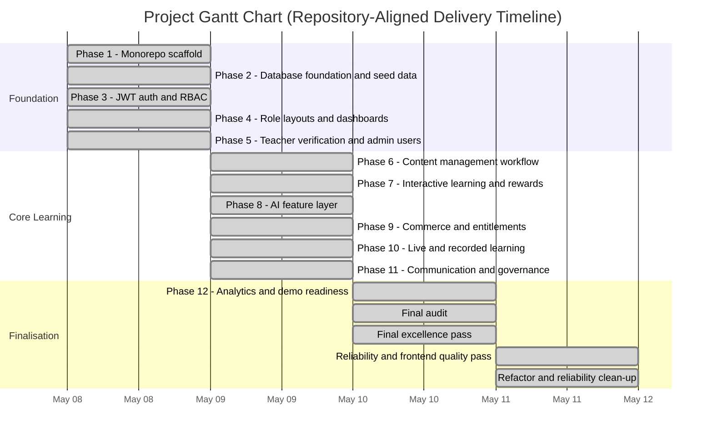

## 21. Work Breakdown Structure Diagram / Table

| WBS ID | Work Package | Key Deliverables |
|---|---|---|
| 1.0 | Project initiation and setup | Monorepo scaffold, frontend and backend structure, Docker Compose, baseline README |
| 1.1 | Frontend environment | Vue 3, Vite, TypeScript, Element Plus, Vue Router, Pinia, i18n |
| 1.2 | Backend environment | Spring Boot 3.5.x, Java 21, Spring Security, JPA, JWT, validation |
| 2.0 | Data foundation | MySQL schema evolution, seed data, entity modeling, repositories |
| 2.1 | Identity and access model | `users`, `roles`, `user_roles`, role guards, route guards |
| 2.2 | Educational domain model | levels, categories, modules, lessons, activities, quizzes |
| 2.3 | Operational domain model | payments, notifications, reports, reviews, support, audit |
| 3.0 | Authentication and authorization | student registration, teacher registration, login, current user, JWT enforcement |
| 3.1 | Security hardening | wrong-role `403`, unauthenticated `401`, backend-only secrets, protected file access |
| 4.0 | Role-specific user experience | public layout, student layout, teacher layout, admin layout |
| 4.1 | Student interface | dashboard, lessons, AI tools, progress, rewards, payments, support |
| 4.2 | Teacher interface | profile, verification, content editing, live classes, recorded lessons, earnings |
| 4.3 | Admin interface | teacher approval, moderation, finance, support, analytics, audit logs |
| 5.0 | Teacher verification subsystem | document upload, admin review, approve/reject, notification, audit trail |
| 6.0 | Content management subsystem | module management, lesson management, package management, content states |
| 6.1 | Lesson authoring | draft/save/update/archive/submit lesson workflow |
| 6.2 | Package authoring | package items, module and lesson bundling |
| 7.0 | Interactive learning subsystem | flashcards, quizzes, matching, listening, tracing |
| 7.1 | Progress and rewards engine | lesson progress, student progress, points, badges, streaks |
| 8.0 | AI subsystem | tutor, vocabulary helper, sentence practice, quiz generator, story generator |
| 8.1 | Teacher AI support | teacher assistant, AI drafting safeguards |
| 8.2 | AI safety and fallback | provider availability checks, usage logs, safe unavailable responses |
| 9.0 | Commerce subsystem | cart, buy now, checkout, payment history, refund requests |
| 9.1 | Access control by entitlement | lesson/package unlocks, subscription handling, premium AI structure |
| 9.2 | Teacher finance flows | earnings, commission, payout requests |
| 10.0 | Live and recorded learning subsystem | live classes, enrolment, meeting-link access, recorded video playback |
| 10.1 | Scheduling | student, teacher, and admin schedule pages |
| 11.0 | Communication and governance subsystem | notifications, reports, reviews, teacher feedback, support tickets |
| 11.1 | Moderation and audit | content moderation records, admin moderation actions, audit logs |
| 12.0 | Analytics and reporting | student, teacher, admin dashboards with ECharts visualizations |
| 12.1 | Documentation and demo readiness | setup docs, API overview, database notes, testing guide, demo script |
| 13.0 | Quality assurance | backend tests, frontend tests, exception handling, regression fixes, refactoring |

## 22. Quiz Scoring and Reward Awarding Flowchart

This flowchart is aligned to `StudentLearningService.submitQuizAttempt(...)` and `StudentLearningProgressService.completeQuiz(...)`.

```mermaid
flowchart TB
    A([Start]) --> B["Student submits answers to /students/quizzes/{quizId}/attempts"]
    B --> C["Validate student role and lesson access"]
    C --> D["Load quiz and ordered quiz questions"]
    D --> E{"Any questions missing answers?"}
    E -- Yes --> F["Reject request with validation error"]
    F --> Z([End])
    E -- No --> G["Create QuizAttempt record"]
    G --> H["Evaluate each answer against question.correctAnswerText"]
    H --> I["Save QuizAttemptAnswer rows"]
    I --> J["Accumulate score, max score, and correct count"]
    J --> K["Calculate percentage = score / maxScore * 100"]
    K --> L{"Percentage >= 60?"}
    L -- Yes --> M["Mark quiz result as passed in response"]
    L -- No --> N["Mark quiz result as not passed in response"]
    M --> O["Call completeQuiz(student, quiz, percentage)"]
    N --> O

    O --> P["Mark QUIZ activity completed for this student"]
    P --> Q["Touch daily streak"]
    Q --> R["Award 20 quiz completion points if first completion"]
    R --> S{"Percentage >= 80?"}
    S -- Yes --> T["Award 10 bonus points if first high-score bonus"]
    T --> U["Award 'Quiz Star' badge if not already owned"]
    S -- No --> V["Skip bonus branch"]
    U --> W["Recalculate lesson completion percent"]
    V --> W

    W --> X{"Lesson now fully completed for the first time?"}
    X -- Yes --> Y["Award 25 lesson completion points and 'Lesson Finisher' badge"]
    X -- No --> AA["No lesson-completion bonus"]
    Y --> AB["If total points >= 50, award 'Point Starter' badge"]
    AA --> AB
    AB --> AC["If first learning activity, award 'First Steps' badge"]
    AC --> AD{"Current streak >= 3 days?"}
    AD -- Yes --> AE["Award 'Streak Explorer' badge if eligible"]
    AD -- No --> AF["Skip streak badge"]
    AE --> AG["Update student progress summary and weak areas"]
    AF --> AG
    AG --> AH["Return score, earned points, total points, pass/fail, answer review"]
    AH --> AI["Wrong answers remain available for review history"]
    AI --> Z([End])
```

