# Proposal Diagram Pack

## Project Title
AI-Powered Interactive Chinese Learning Platform for Young Learners

## Introduction
This document presents the proposal version of the diagrams for the project.  
All diagrams are based on the actual planned scope of the platform, but they are written from a proposal perspective, which means the system is presented as a designed and proposed solution rather than a completed implementation.  

The diagrams are intentionally simplified to make them:
- easy to understand
- suitable for academic proposal writing
- complete enough to explain the planned system clearly
- consistent with the real project scope, roles, modules, and workflows

## 1. Conceptual Framework Diagram

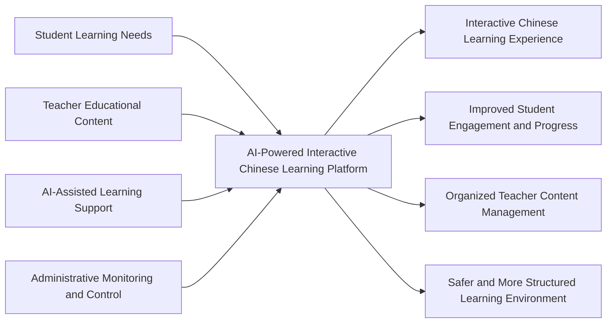

## 2. Development Methodology Flow Diagram

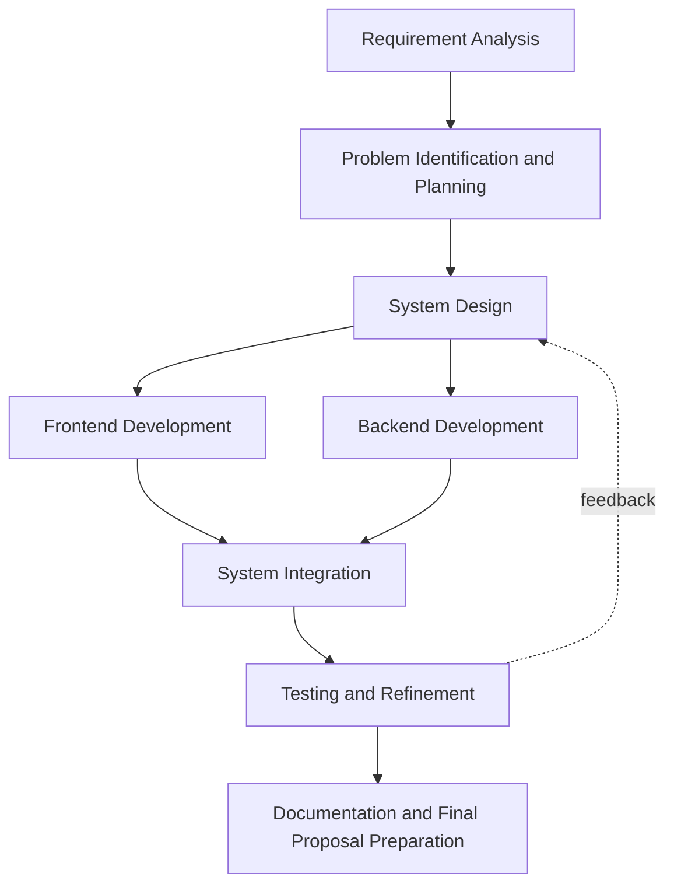

## 3. System Architecture Diagram

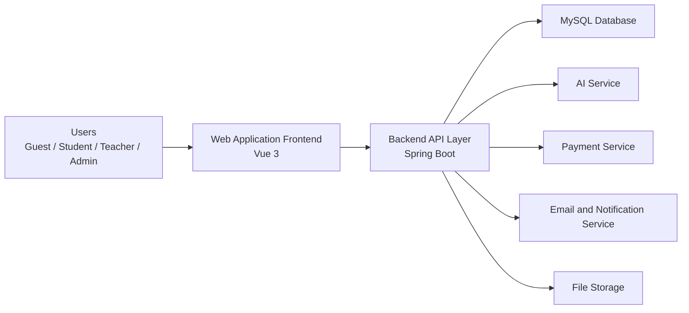

## 4. System Context Diagram

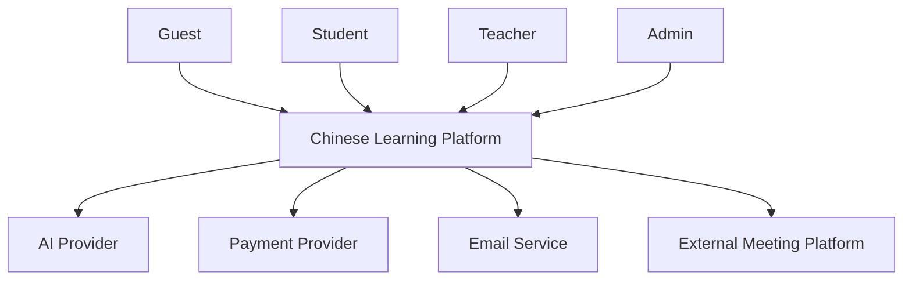

## 5. Overall Use Case Diagram

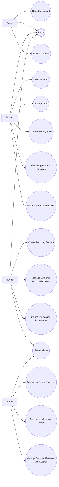

## 6. Entity Relationship Diagram

This proposal ERD includes only the most important entities needed to explain the planned system clearly.

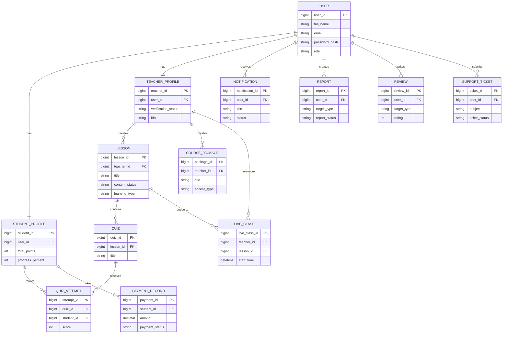

## 7. Component Diagram

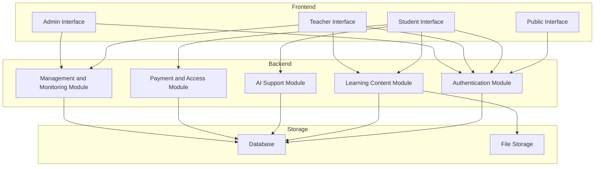

## 8. Deployment Diagram

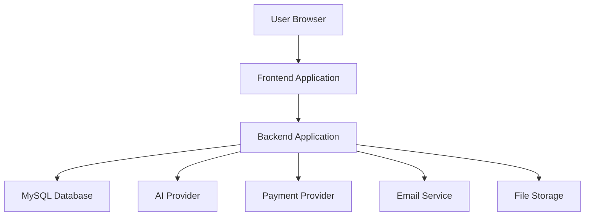

## 9. Activity Diagram - Student Learning Flow

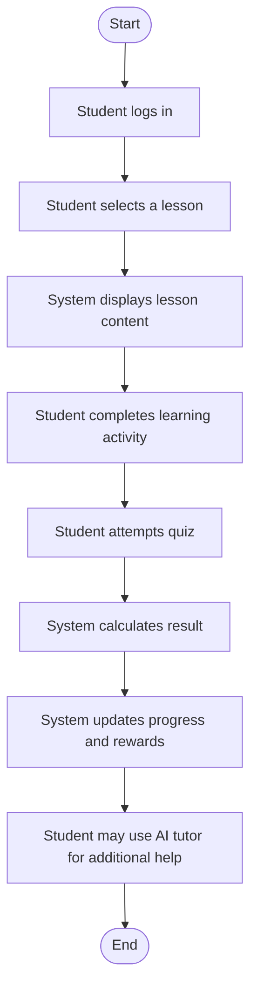

## 10. Activity Diagram - Teacher Content Creation Flow

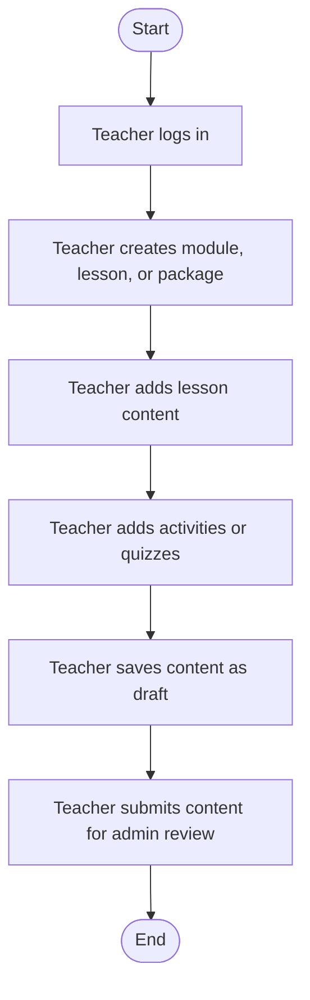

## 11. Activity Diagram - Administrator Teacher Verification Flow

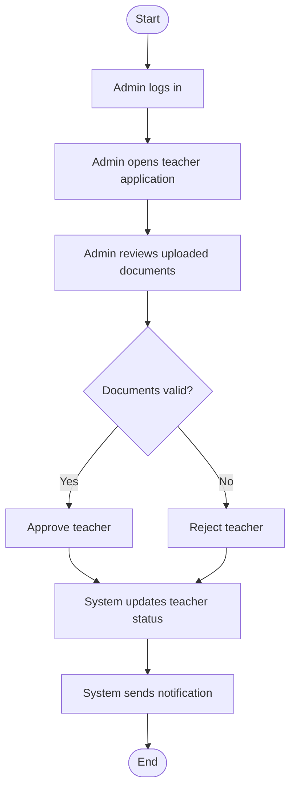

## 12. Sequence Diagram - User Login

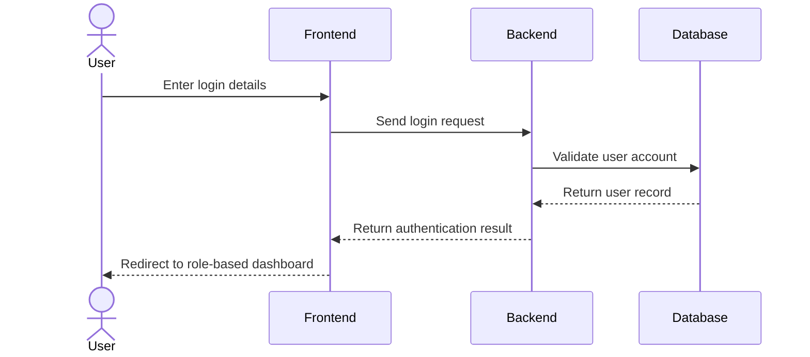

## 13. Sequence Diagram - AI Chat Tutor Request

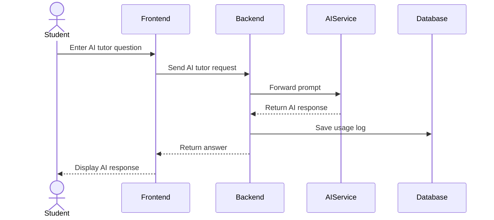

## 14. Sequence Diagram - Quiz Attempt

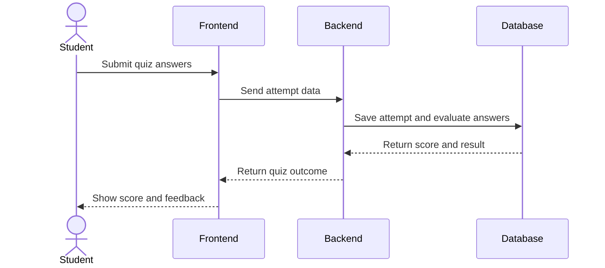

## 15. Sequence Diagram - Teacher Content Creation

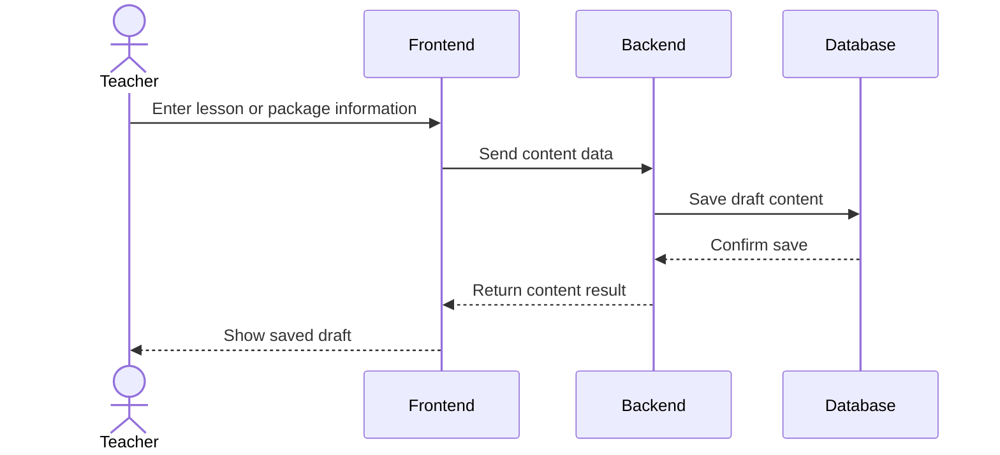

## 16. Sequence Diagram - Admin Teacher Verification

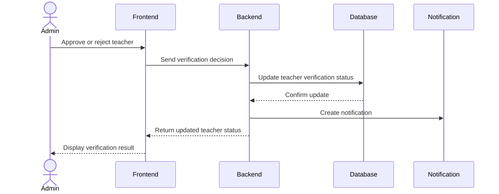

## 17. State Machine Diagram - Teacher Verification Status

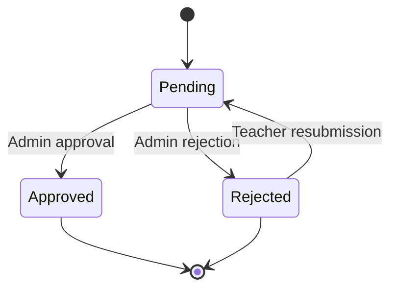

## 18. Site Map / Navigation Flow Diagram

```mermaid
flowchart TB
    Home["Home"]

    Home --> Login["Login"]
    Home --> Register["Register"]
    Home --> Courses["Course Discovery"]
    Home --> FAQ["FAQ"]
    Home --> Legal["Terms / Privacy / Safety"]
    Home --> TeacherProfile["Teacher Public Profile"]

    Login --> StudentDashboard["Student Dashboard"]
    Login --> TeacherDashboard["Teacher Dashboard"]
    Login --> AdminDashboard["Admin Dashboard"]

    StudentDashboard --> StudentLessons["Lessons"]
    StudentDashboard --> StudentAI["AI Tools"]
    StudentDashboard --> StudentProgress["Progress"]
    StudentDashboard --> StudentRewards["Rewards"]
    StudentDashboard --> StudentPayments["Payments"]
    StudentDashboard --> StudentSupport["Support"]

    TeacherDashboard --> TeacherProfilePage["Profile"]
    TeacherDashboard --> TeacherVerification["Verification"]
    TeacherDashboard --> TeacherContent["Content Management"]
    TeacherDashboard --> TeacherClasses["Live and Recorded Classes"]
    TeacherDashboard --> TeacherAI["AI Assistant"]
    TeacherDashboard --> TeacherEarnings["Earnings"]

    AdminDashboard --> AdminTeachers["Teacher Approval"]
    AdminDashboard --> AdminContent["Content Approval"]
    AdminDashboard --> AdminReports["Reports and Reviews"]
    AdminDashboard --> AdminSupport["Support Management"]
    AdminDashboard --> AdminAnalytics["Analytics"]
```

## 19. Selected UI Wireframes

### 19.1 Home Page Wireframe

```text
+-------------------------------------------------------------------+
| Header: Logo | Home | Courses | FAQ | Login | Register            |
+-------------------------------------------------------------------+
| Hero Section                                                      |
| AI-Powered Chinese Learning for Young Learners                    |
| Short project introduction                                        |
| Buttons: Explore Courses | Get Started                            |
+-------------------------------------------------------------------+
| Feature Section                                                   |
| Interactive Lessons | AI Tutor | Teacher Support | Progress Track |
+-------------------------------------------------------------------+
| Footer                                                            |
+-------------------------------------------------------------------+
```

### 19.2 Student Dashboard Wireframe

```text
+-------------------------------------------------------------------+
| Sidebar: Dashboard | Lessons | AI Tools | Progress | Rewards      |
+-------------------------------------------------------------------+
| Welcome Card                                                      |
| Student name | Learning summary | Continue Learning button        |
+-------------------------------------------------------------------+
| Summary Cards                                                     |
| Progress | Points | Streak | Badges                              |
+-------------------------------------------------------------------+
| Main Content                                                      |
| Recommended lessons                                               |
| Recent quiz results                                               |
| Quick AI support                                                  |
+-------------------------------------------------------------------+
```

### 19.3 Teacher Content Management Wireframe

```text
+-------------------------------------------------------------------+
| Sidebar: Dashboard | Profile | Verification | Lessons | Packages  |
+-------------------------------------------------------------------+
| Page Title: Lesson / Content Editor                               |
+-------------------------------------------------------------------+
| Form Section                                                      |
| Title                                                             |
| Description                                                       |
| Level | Category | Learning Type | Access Type                    |
| Main Content                                                      |
| Save Draft | Submit                                               |
+-------------------------------------------------------------------+
```

### 19.4 Admin Teacher Verification Wireframe

```text
+-------------------------------------------------------------------+
| Sidebar: Dashboard | Teacher Approval | Reports | Support         |
+-------------------------------------------------------------------+
| Verification Detail Page                                          |
| Teacher Name                                                      |
| Email                                                             |
| Verification Status                                               |
| Uploaded Documents                                                |
| Buttons: Approve | Reject                                         |
+-------------------------------------------------------------------+
```

## 20. Gantt Chart

This chart presents a proposal-style project schedule for planning purposes.

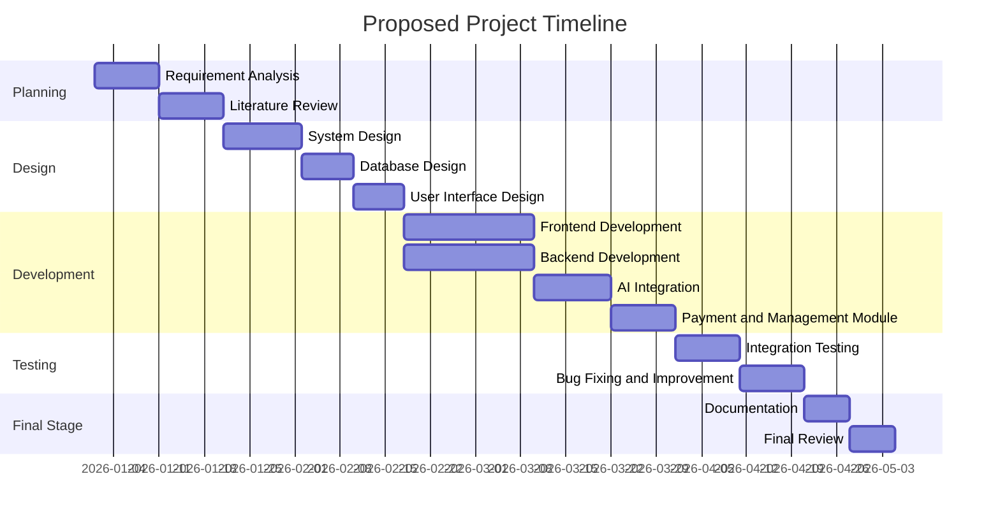

## 21. Work Breakdown Structure Diagram / Table

| WBS | Task | Description |
|---|---|---|
| 1.0 | Project Planning | Define project scope, objectives, and requirements |
| 2.0 | System Analysis and Design | Design system structure, data model, and interfaces |
| 2.1 | Interface Design | Prepare page layouts and wireframes |
| 2.2 | Database Design | Define key entities and relationships |
| 3.0 | Frontend Development | Develop interfaces for guest, student, teacher, and admin |
| 4.0 | Backend Development | Develop authentication, lesson, AI, and management functions |
| 5.0 | AI Integration | Add AI tutor and AI-based learning support |
| 6.0 | Payment and Access Control | Add payment, subscription, and access features |
| 7.0 | Testing and Evaluation | Perform system testing and refinement |
| 8.0 | Documentation | Prepare proposal, report, and diagrams |

## 22. Quiz Scoring and Reward Awarding Flowchart

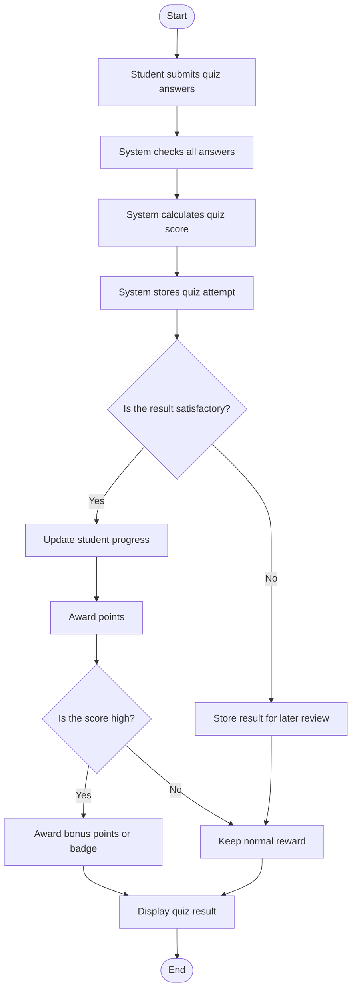

